# Sesión 7 — Historias de usuario, casos de uso y modelos

- **Proyecto:** P03 — Inscripciones a talleres y listas de espera
- **Integrantes:** Gonzalo Cárdenas, Santiago Arauz, Andrea Trujillo
- **Requisitos de origen:** [sesion-06-requisitos.md](sesion-06-requisitos.md)
- **Planilla de historias, casos de uso y cumplimiento:** [proyectoTalleres.xlsx](https://docs.google.com/spreadsheets/d/1oyhV76VcpE20u-caiYUrRQok9BZoxhekKmNNaoeJrDQ/edit?usp=sharing)
- **Contenido:** el diagrama de casos de uso del sistema y las 12 historias de usuario agrupadas por rol (coordinador, operador, participante y funciones compartidas). Cada historia tiene sus casos de uso con su redacción completa, su diagrama de flujo y su diagrama de secuencia. El flujo elegido para el detalle de la sesión 7 es **HU-02 / CU-04 — Solicitar plaza** (sección 6.1), que además incluye la tabla de estados de la inscripción.

## 1. Requisitos, historias de usuario y casos de uso

Cada requisito de la sesión 6 se cumple con al menos una historia de usuario y uno o más casos de uso. Todos están implementados y comprobados con pruebas automáticas.

| Requisito | Qué pide | Historias de usuario | Casos de uso |
|---|---|---|---|
| TAL-RF-01 | Solicitud con plaza disponible | HU-02 | CU-04 |
| TAL-RF-02 | Lista de espera con límite del 20 % | HU-02 | CU-04 |
| TAL-RF-03 | Asignación automática de una plaza liberada | HU-05 | CU-05 |
| TAL-RF-04 | Volver a inscribirse después de cancelar | HU-02 | CU-04 |
| TAL-RF-05 | Choque de horario entre talleres | HU-02 | CU-04 |
| TAL-RF-06 | Plazo para cancelar | HU-05 | CU-05 |
| TAL-RF-07 | Cambio de cupo del taller | HU-04 | CU-06 |
| TAL-RF-08 | Bloqueo por exceso de cancelaciones | HU-09 | CU-11, CU-12 |
| TAL-RF-09 | Roles, inicio de sesión y aprobación de talleres | HU-01, HU-03, HU-12 | CU-01, CU-02, CU-15 |
| TAL-RF-10 | Edición del taller con motivo e historial | HU-04, HU-03 | CU-06, CU-02 |
| TAL-RF-11 | Cancelación de un taller completo | HU-01 | CU-07 |
| TAL-RF-12 | Categorías y búsqueda por categoría | HU-11, HU-04 | CU-03, CU-14 |
| TAL-RF-13 | Avisos en pantalla | HU-06 | CU-10 |
| TAL-RF-14 | Consultas del operador | HU-07, HU-08, HU-10 | CU-08, CU-09, CU-13 |
| TAL-RC-01 | Solicitudes simultáneas por la última plaza | HU-02 | CU-04 |
| TAL-RC-02 | Mensaje claro ante un rechazo | Todas | Todos |
| TAL-RC-03 | Pirámide de pruebas | Todas | Todos |
| TAL-RT-01 | Lenguaje del proyecto (Python) | Todas | Todos |
| TAL-RT-02 | Formato del identificador del taller | HU-01 | CU-01 |
| TAL-RT-03 | Cupo permitido (4 a 40) | HU-01, HU-04 | CU-01, CU-06 |
| TAL-RT-04 | Base de datos SQLite | Todas | Todos |

### Historias de usuario por rol

| Rol | Historia | Quiere | Casos de uso | Sección |
|---|---|---|---|---|
| Coordinador | HU-01 | publicar talleres con nombre, categoría, cupo y horario, y poder cancelarlos | CU-01, CU-03, CU-07 | 4.1 |
| Coordinador | HU-04 | cambiar las fechas y el cupo de mis talleres eligiendo un motivo de la lista | CU-06, CU-14 | 4.2 |
| Coordinador | HU-07 | consultar la ocupación de mis talleres | CU-08 | 4.3 |
| Operador | HU-03 | aceptar o rechazar los talleres y las ediciones que piden los coordinadores | CU-02 | 5.1 |
| Operador | HU-09 | ver el historial de cancelaciones, saber quién está bloqueado y poder levantar el bloqueo | CU-11, CU-12 | 5.2 |
| Operador | HU-10 | buscar inscripciones por participante o por taller | CU-13 | 5.3 |
| Participante | HU-02 | solicitar una plaza en un taller | CU-04 | 6.1 |
| Participante | HU-05 | cancelar mi inscripción o mi lugar en la lista de espera | CU-05 | 6.2 |
| Participante | HU-08 | consultar el estado de mis inscripciones | CU-09 | 6.3 |
| Participante | HU-11 | buscar talleres por categoría | CU-03, CU-14 | 6.4 |
| Funciones compartidas | HU-06 | ver en pantalla los avisos de lo que cambió | CU-10 | 7.1 |
| Funciones compartidas | HU-12 | crear mi cuenta si soy estudiante, entrar con mi código y contraseña y ver solo las opciones de mi rol | CU-15 | 7.2 |

## 2. Diagrama de casos de uso

Muestra **qué puede hacer cada rol** en el sistema, sin entrar en el orden de los pasos. Las líneas indican que el actor participa en ese caso de uso, no un orden. El rectángulo es el límite del sistema: lo que está adentro lo resuelve el sistema.

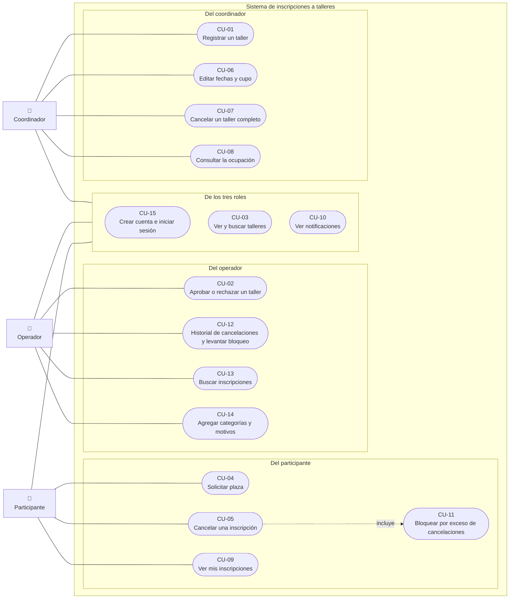

| Rol | Qué hace en el sistema | Casos de uso propios |
|---|---|---|
| **Coordinador** | Crea, edita y cancela **sus** talleres y revisa su ocupación | CU-01, CU-06, CU-07, CU-08 |
| **Operador** | Aprueba o rechaza talleres, mantiene categorías y motivos, busca inscripciones y maneja los bloqueos. También puede hacer todo lo del coordinador y actuar a nombre de un participante | CU-02, CU-12, CU-13, CU-14 |
| **Participante** | Pide plaza, cancela y revisa sus inscripciones; si cancela demasiado, el sistema lo bloquea | CU-04, CU-05, CU-09 (y CU-11, que aplica el sistema) |
| **Los tres** | Entran al sistema, buscan talleres y ven sus avisos | CU-03, CU-10, CU-15 |

`incluye` significa que, cada vez que un participante cancela (CU-05), el sistema revisa si corresponde el bloqueo (CU-11).

## 3. Cómo leer los diagramas

**Diagramas de casos de uso.** Muestran qué hace cada rol (sección 2 y el inicio de cada parte).

**Diagramas de flujo.** Muestran las decisiones que toma el sistema, de arriba hacia abajo. Los rombos son preguntas (Sí / No) y los rectángulos son lo que el sistema hace. Todos los caminos terminan en «Fin».

**Diagramas de secuencia.** Muestran qué parte del sistema le pide qué a cuál, en orden. Los pasos están numerados para poder explicarlos uno por uno. Las columnas son siempre las mismas:

| Columna | Qué es | Dónde está en el proyecto |
|---|---|---|
| Actor | La persona que usa el sistema: participante, coordinador u operador | — |
| **Frontend** | La pantalla HTML que ve la persona | `inscripciones/templates/inscripciones/` |
| **Backend: vista** | La función que recibe el pedido de la pantalla y llama a la regla | `inscripciones/views.py` (las rutas están en `urls.py`) |
| **Backend: servicio** | Donde están las reglas del negocio | `inscripciones/servicios/` |
| **Base de datos** | Donde se guardan talleres, usuarios, inscripciones, historiales y avisos | `db.sqlite3` y el padrón `estudiantes_estatica.sqlite3` |

Las flechas continuas son pedidos y las punteadas son respuestas. `alt` muestra caminos distintos según lo que pase (éxito o rechazo) y `opt` muestra pasos que solo ocurren a veces.

## 4. Coordinador

El coordinador organiza sus talleres: los crea, cambia sus fechas y su cupo cuando hay un imprevisto, los cancela si no se van a dictar y revisa cuántos inscritos tiene. Solo ve y maneja **sus** talleres, y lo que crea o edita queda pendiente hasta que el operador lo aprueba.

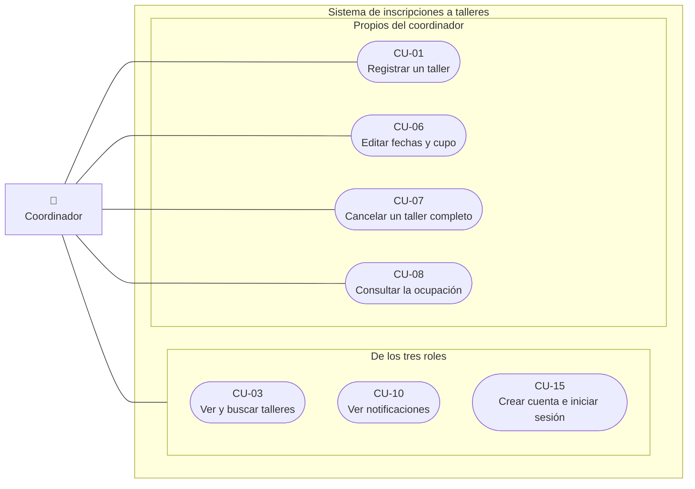

El operador también puede hacer todo lo del coordinador, sobre cualquier taller.

Historias de esta parte: HU-01 (publicar y cancelar talleres), HU-04 (editar fechas y cupo de un taller), HU-07 (consultar la ocupación).

### 4.1 HU-01 — Publicar y cancelar talleres

**Historia de usuario:** Como coordinador (también operador), quiero publicar talleres con nombre, categoría, cupo y horario, y poder cancelarlos para que los participantes vean la oferta y se inscriban.

- **Criterio de aceptación:** Cada taller recibe un código único según su actividad («Taller de Danza» → TAL-DAN-01; el siguiente de danza → TAL-DAN-02). Cupo entre 4 y 40, inicio futuro, fin posterior al inicio, duración máxima de 7 días y categoría obligatoria. Si lo pide un coordinador queda Pendiente hasta que el operador lo apruebe; si lo crea el operador queda Aprobado. El coordinador ve y maneja solo sus talleres. Un taller que no empezó se puede cancelar: sus inscritos y su espera quedan cancelados y reciben un aviso.
- **Requisitos que cumple:** TAL-RF-09, TAL-RF-11, TAL-RT-02, TAL-RT-03
- **Casos de uso:** CU-01, CU-03, CU-07
- **Pruebas:** `test_coordinador.py`, `test_operador.py`, `test_decidir_taller.py`

#### 4.1.1 CU-01 — Registrar un taller

| Campo | Descripción |
|---|---|
| Actor | Coordinador (también Operador) |
| Objetivo | Crear un taller con código único, categoría, cupo y horario |
| Disparador | Elige «Crear taller» |
| Precondiciones | Inició sesión como coordinador u operador |
| Poscondición de éxito | Taller guardado con su código: Pendiente y a su nombre si lo creó el coordinador; Aprobado si lo creó el operador |

**Flujo principal**

1. El usuario indica nombre, categoría, cupo, inicio y fin.
2. El sistema valida cupo 4–40, inicio futuro, fin posterior al inicio y duración de hasta 7 días.
3. Toma las 3 primeras letras de la actividad del nombre (sin «taller», «de», «la»…).
4. Genera el código TAL-<actividad>-<número siguiente>.
5. Guarda el taller (Pendiente o Aprobado según el rol).
6. Vuelve a la lista de talleres.

**Rechazos y excepciones**

- E1. Dato faltante o fuera de rango: muestra el error y no guarda.
- E2. El nombre no tiene una actividad de 3 letras: lo rechaza.
- E3. Otro pedido toma el mismo número a la vez: reintenta con el siguiente.
- E4. Un participante intenta entrar: 403.

**Diagrama de flujo**

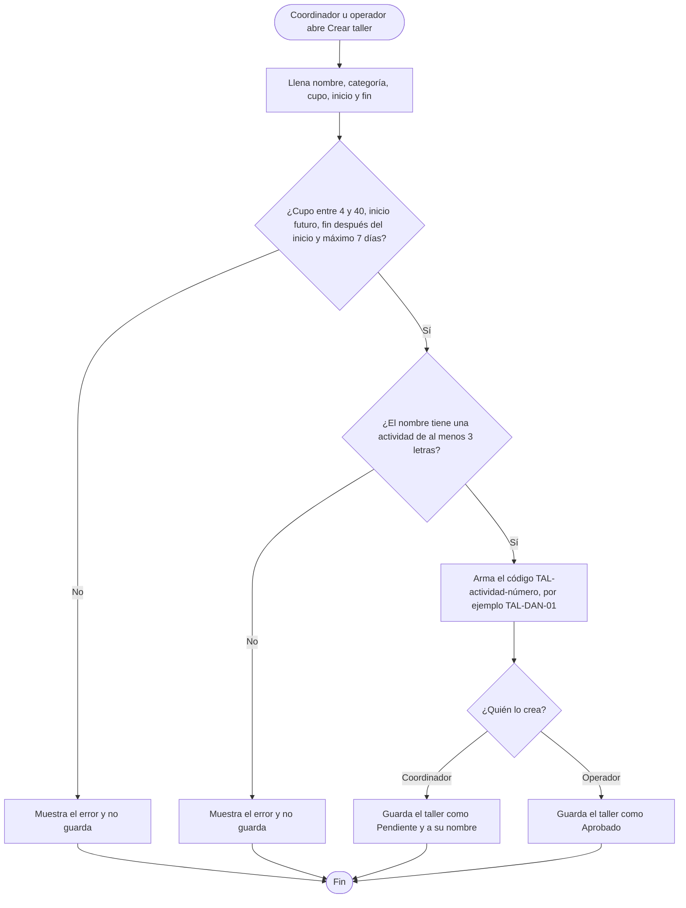

**Diagrama de secuencia**

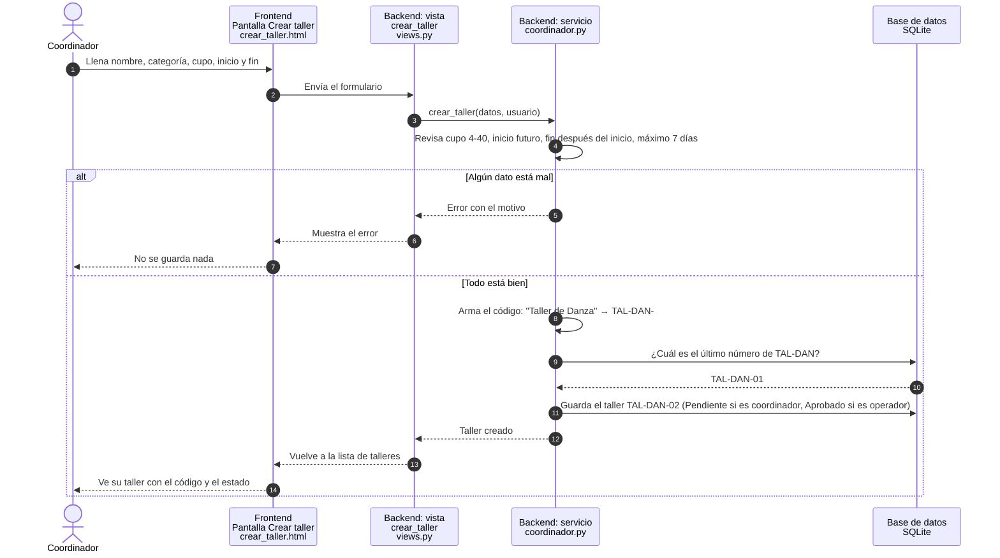

#### 4.1.2 CU-03 — Ver y buscar talleres

| Campo | Descripción |
|---|---|
| Actor | Participante, Coordinador u Operador |
| Objetivo | Consultar talleres con fecha, cupo y disponibilidad, todos o de una categoría |
| Disparador | Entra a «Talleres» o a «Por categoría» |
| Precondiciones | Inició sesión |
| Poscondición de éxito | Ve la lista; no se modifican datos |

**Flujo principal**

1. El sistema obtiene los talleres con confirmados y personas en espera.
2. Filtra según el rol: participante, solo aprobados, no cancelados y que no empezaron; coordinador, solo los suyos; operador, todos.
3. En «Por categoría», el usuario elige una categoría o «Todas» y se filtra por ella.
4. Muestra código, nombre, fechas, cupo, libres, espera/máximo, estado y los botones de su rol.

**Rechazos y excepciones**

- E1. No hay talleres: mensaje informativo.
- E2. Categoría inválida: muestra todos.

**Diagrama de flujo**

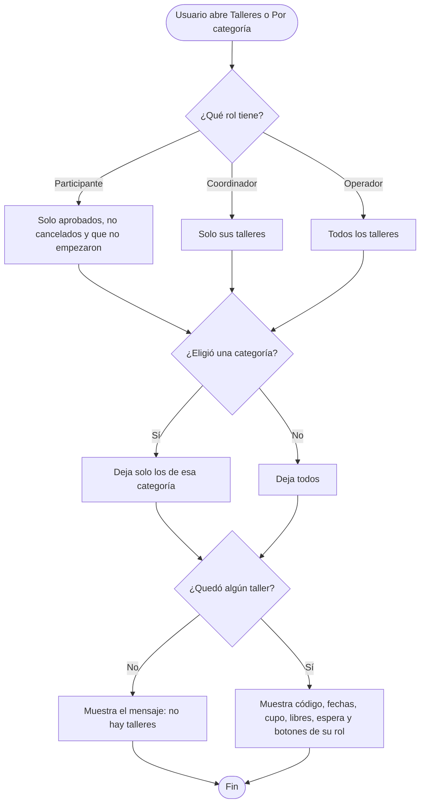

**Diagrama de secuencia**

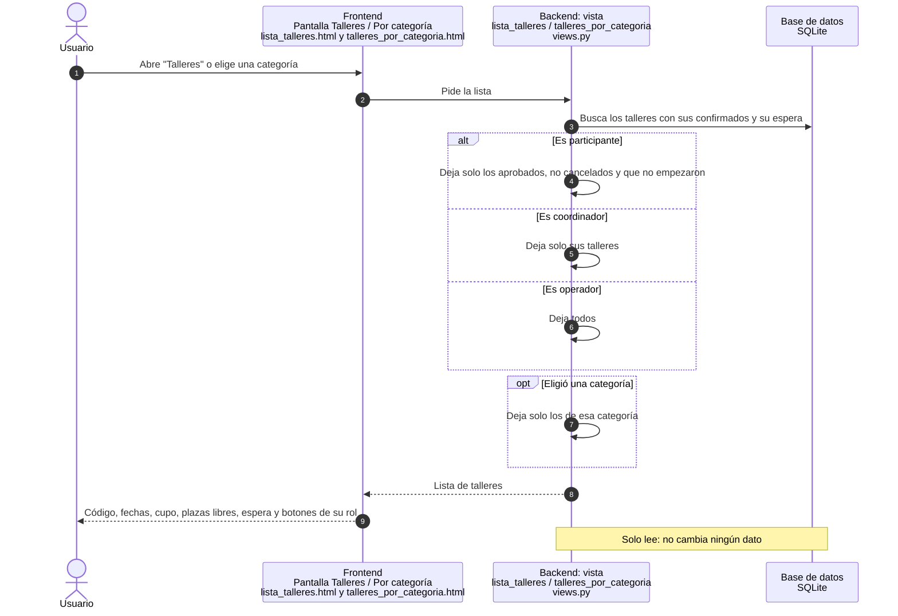

#### 4.1.3 CU-07 — Cancelar un taller completo

| Campo | Descripción |
|---|---|
| Actor | Coordinador (sus talleres) u Operador |
| Objetivo | Dar de baja un taller que no se va a dictar |
| Disparador | Presiona «Cancelar taller» y confirma |
| Precondiciones | Inició sesión; el taller existe |
| Poscondición de éxito | Taller cancelado (se conserva); confirmados y espera pasan a Cancelado y reciben aviso; no cuenta para el bloqueo |

**Flujo principal**

1. El usuario confirma la cancelación.
2. El sistema verifica permisos, que no esté cancelado y que no haya empezado.
3. Avisa a cada inscrito y a cada persona en espera.
4. Pasa esas inscripciones a Cancelado.
5. Marca el taller como cancelado.

**Rechazos y excepciones**

- E1. Taller ajeno: «No puedes hacer cambios en un taller que no es tuyo.»
- E2. Ya cancelado: «El taller ya estaba cancelado.»
- E3. Ya empezó: «El taller ya empezó y no se puede cancelar.»

**Diagrama de flujo**

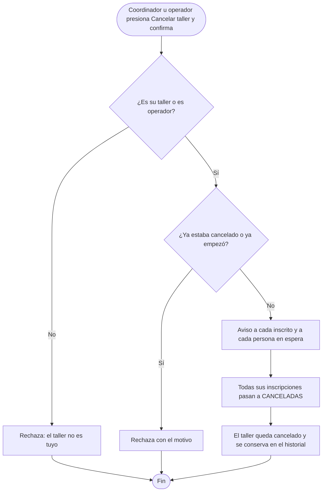

**Diagrama de secuencia**

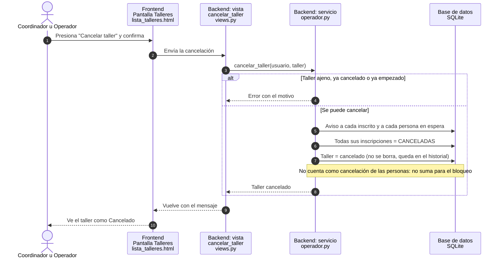

### 4.2 HU-04 — Editar fechas y cupo de un taller

**Historia de usuario:** Como coordinador (también operador), quiero cambiar las fechas y el cupo de mis talleres eligiendo un motivo de la lista para ajustar el taller a imprevistos sin perder el historial de cambios.

- **Criterio de aceptación:** Solo se editan fechas y cupo de un taller que no empezó ni está cancelado; nombre y categoría no cambian. El motivo se elige de la lista parametrizada (4 motivos más comunes, ampliable por el operador). Se guardan los datos anteriores con el motivo y la fecha. Si el cupo sube, la espera pasa a Confirmado en orden; el cupo no baja de los confirmados. Si edita el coordinador, el taller vuelve a Pendiente hasta que el operador lo apruebe.
- **Requisitos que cumple:** TAL-RF-07, TAL-RF-10, TAL-RF-12, TAL-RT-03
- **Casos de uso:** CU-06, CU-14
- **Pruebas:** `test_coordinador.py`, `test_edicion_taller.py`, `test_editar_taller_pantalla.py`, `test_catalogos_operador.py`

#### 4.2.1 CU-06 — Editar fechas y cupo de un taller

| Campo | Descripción |
|---|---|
| Actor | Coordinador (sus talleres) u Operador |
| Objetivo | Corregir fechas o cupo conservando el motivo y el historial |
| Disparador | Elige «Editar» en un taller |
| Precondiciones | Inició sesión; el taller existe |
| Poscondición de éxito | Fechas y cupo actualizados; historial con datos anteriores, motivo y fecha; Pendiente si editó el coordinador |

**Flujo principal**

1. El sistema muestra cupo, inicio, fin y la lista de motivos.
2. El usuario cambia datos y elige un motivo.
3. El sistema valida permisos, que el taller no esté cancelado ni haya empezado, el motivo, el cupo (4–40 y no menor que los confirmados) y las fechas.
4. Guarda el historial y actualiza el taller (Pendiente si editó el coordinador).
5. Si el cupo subió, confirma a la espera en orden hasta llenarlo y avisa a cada promovido.

**Rechazos y excepciones**

- E1. Datos inválidos o sin motivo: no guarda.
- E2. Taller cancelado o ya empezado: no se puede editar («No puedes editar un taller que ha sido cancelado.» / «El taller ya empezó y no se puede editar.»).
- E3. Coordinador con taller ajeno: 403.
- E4. Cupo menor que los confirmados: «No se puede bajar el cupo a N: ya hay M participantes confirmados.»
- E5. El operador rechaza la edición: ver CU-02.

**Diagrama de flujo**

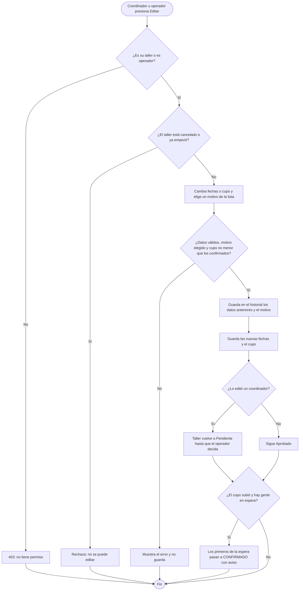

**Diagrama de secuencia**

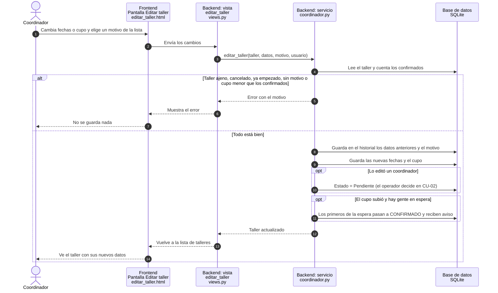

#### 4.2.2 CU-14 — Agregar categorías y motivos de edición

| Campo | Descripción |
|---|---|
| Actor | Operador |
| Objetivo | Ampliar las listas parametrizadas |
| Disparador | Entra a «Categorías y motivos» |
| Precondiciones | Inició sesión como operador |
| Poscondición de éxito | La nueva categoría o motivo aparece al crear o editar talleres |

**Flujo principal**

1. El sistema muestra las categorías y motivos actuales.
2. El operador escribe uno nuevo.
3. El sistema quita espacios, verifica que no esté vacío ni repetido (sin importar mayúsculas) y lo guarda.

**Rechazos y excepciones**

- E1. Vacío: lo rechaza.
- E2. Repetido: «Ya existe una categoría con ese nombre.» / «Ya existe un motivo con esa descripción.»
- E3. Otro rol: 403.

**Diagrama de flujo**

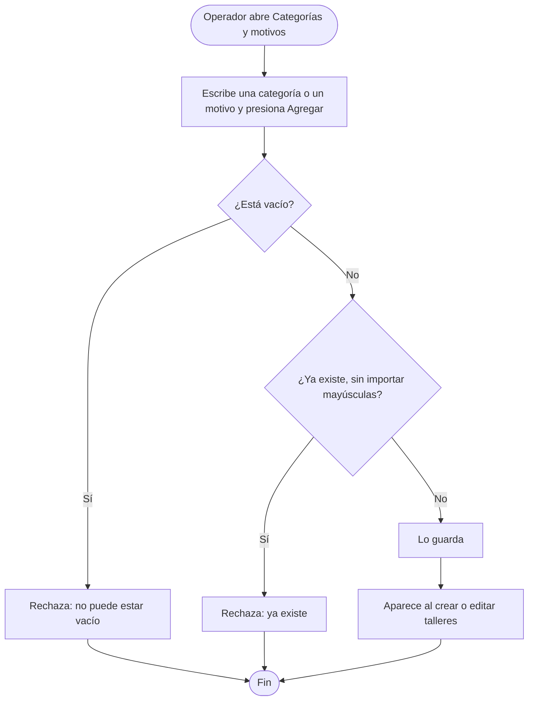

**Diagrama de secuencia**

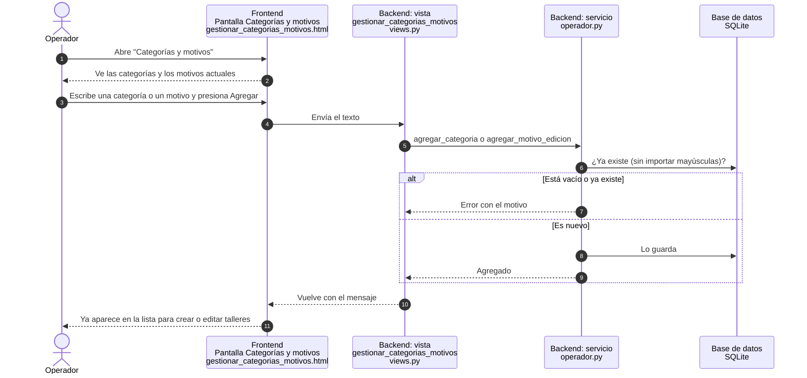

### 4.3 HU-07 — Consultar la ocupación

**Historia de usuario:** Como coordinador (también operador), quiero consultar la ocupación de mis talleres para saber cuántas plazas están ocupadas, cuántas libres y cuántas personas esperan.

- **Criterio de aceptación:** Muestra cupo, ocupadas, libres (nunca negativas) y «en espera de máximo»; los cancelados no cuentan. El coordinador solo ve sus talleres (uno ajeno responde 403); el operador ve todos. No modifica datos.
- **Requisitos que cumple:** TAL-RF-14
- **Casos de uso:** CU-08
- **Pruebas:** `test_operador.py`, `test_coordinador_solo_lo_suyo.py`

#### 4.3.1 CU-08 — Consultar la ocupación de un taller

| Campo | Descripción |
|---|---|
| Actor | Coordinador (sus talleres) u Operador |
| Objetivo | Saber cuántas plazas están ocupadas y libres y cuántas personas esperan |
| Disparador | Presiona «Ver ocupación» |
| Precondiciones | Inició sesión; el taller existe |
| Poscondición de éxito | Ve cupo, ocupadas, libres y espera/máximo; no se modifican datos |

**Flujo principal**

1. El sistema cuenta Confirmados y En espera (los cancelados no cuentan).
2. Calcula libres = cupo − confirmados (mínimo 0) y el máximo de espera.
3. Muestra los datos y «(lleno)» si no quedan plazas.

**Rechazos y excepciones**

- E1. Taller inexistente: 404.
- E2. Coordinador con taller ajeno: 403.

**Diagrama de flujo**

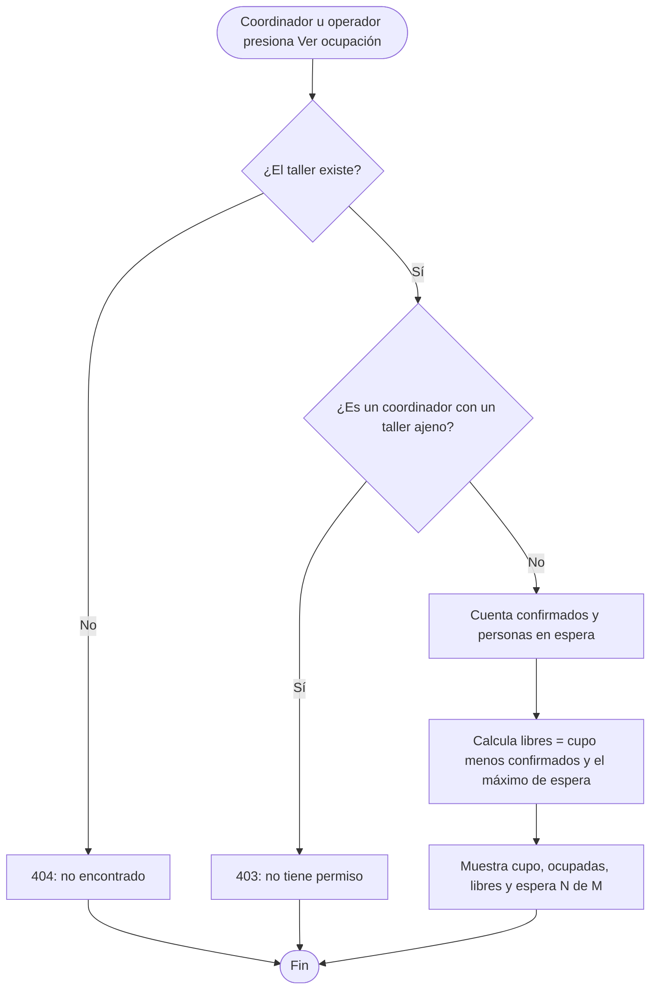

**Diagrama de secuencia**

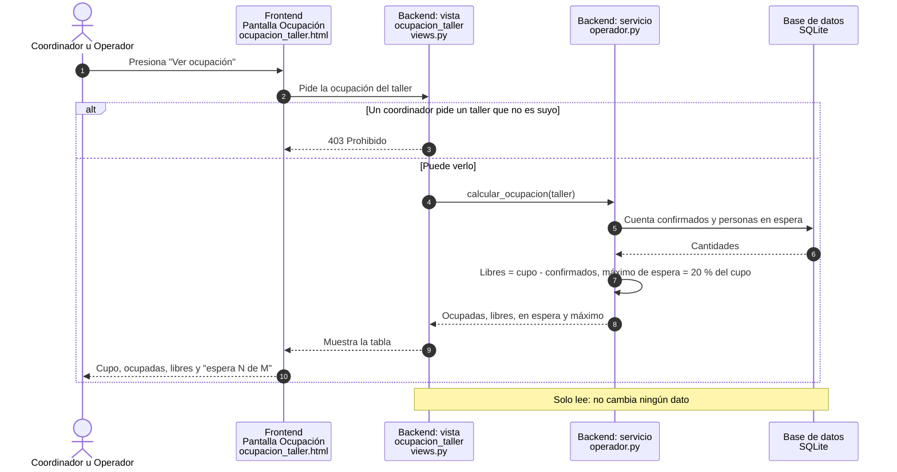

## 5. Operador

El operador es el administrador del sistema: decide qué talleres se publican, mantiene las listas de categorías y motivos, busca inscripciones, revisa el historial de cancelaciones y puede levantar un bloqueo.

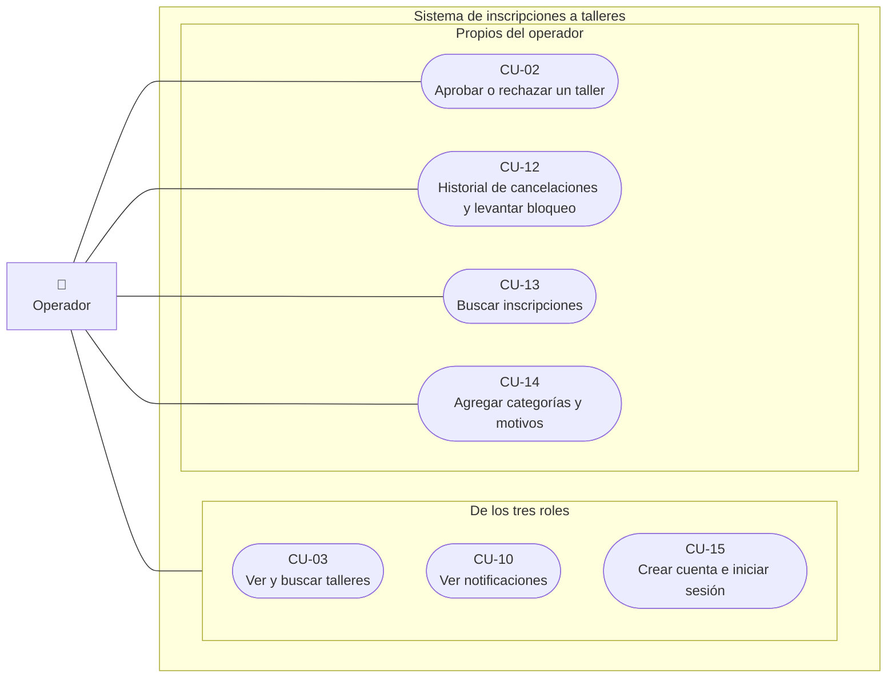

Además puede hacer todo lo del coordinador sobre cualquier taller e inscribir o cancelar a nombre de un participante (CU-04 y CU-05).

Historias de esta parte: HU-03 (aprobar o rechazar talleres), HU-09 (historial de cancelaciones y bloqueo), HU-10 (buscar inscripciones).

### 5.1 HU-03 — Aprobar o rechazar talleres

**Historia de usuario:** Como operador, quiero aceptar o rechazar los talleres y las ediciones que piden los coordinadores para que solo se publique lo que la organización aprobó.

- **Criterio de aceptación:** Solo se decide sobre talleres Pendientes y no cancelados. Aprobado: recibe inscripciones. Rechazado: no se publica y el coordinador puede corregirlo. Si se rechaza la edición de un taller que ya tiene inscritos, vuelve a sus fechas y cupo anteriores, sigue Aprobado y nadie pierde su plaza. El coordinador y los inscritos reciben el aviso.
- **Requisitos que cumple:** TAL-RF-09, TAL-RF-10
- **Casos de uso:** CU-02
- **Pruebas:** `test_operador.py`, `test_decidir_taller.py`, `test_notificaciones.py`

#### 5.1.1 CU-02 — Aprobar o rechazar un taller

| Campo | Descripción |
|---|---|
| Actor | Operador |
| Objetivo | Decidir si se publica un taller o una edición pedida por un coordinador |
| Disparador | Presiona «Aprobar» o «Rechazar» en «Pendientes» |
| Precondiciones | Inició sesión como operador |
| Poscondición de éxito | Aprobado: recibe inscripciones. Rechazado: no se publica. Edición rechazada con inscritos: vuelve a sus datos anteriores y sigue Aprobado. Avisos enviados |

**Flujo principal**

1. El operador abre «Pendientes».
2. Elige aprobar o rechazar un taller.
3. El sistema verifica que no esté cancelado y siga Pendiente.
4a. Aprobar: queda Aprobado y avisa al coordinador.
4b. Rechazar sin inscritos: queda Rechazado y avisa al coordinador.
4c. Rechazar con inscritos (era una edición): vuelve a las fechas y cupo anteriores (el cupo no baja de los confirmados), confirma a la espera si hay lugar, sigue Aprobado y avisa al coordinador y a los inscritos.

**Rechazos y excepciones**

- E1. No está Pendiente: «Solo se puede aceptar o rechazar un taller que está pendiente.»
- E2. Está cancelado: «El taller fue cancelado: ya no se puede aceptar ni rechazar.»

**Diagrama de flujo**

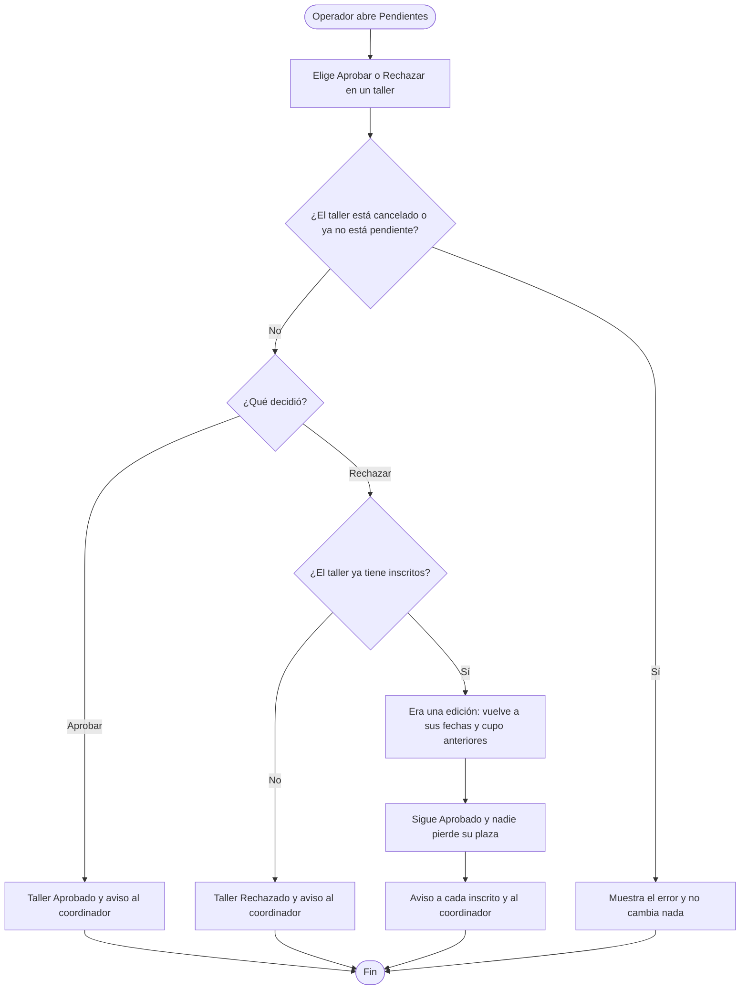

**Diagrama de secuencia**

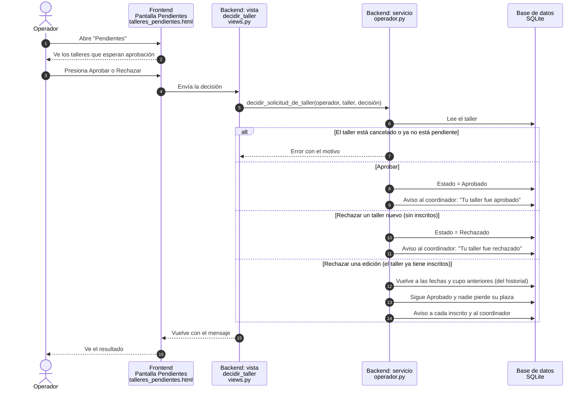

### 5.2 HU-09 — Historial de cancelaciones y bloqueo

**Historia de usuario:** Como operador, quiero ver el historial de cancelaciones, saber quién está bloqueado y poder levantar el bloqueo para que quien cancela demasiado no quite oportunidades a los demás.

- **Criterio de aceptación:** Más de 3 cancelaciones en 72 horas bloquean 24 horas: no puede inscribirse y pierde sus inscripciones y lugares de espera en talleres que no empezaron (sus plazas pasan al siguiente en espera). Si vuelve a pasar, otra vez 24 horas. El operador ve el historial y hasta cuándo dura el bloqueo, y puede levantarlo cuando quiera: el historial se conserva completo y queda registrado quién lo levantó y cuándo. Cancelar un taller completo no cuenta.
- **Requisitos que cumple:** TAL-RF-08
- **Casos de uso:** CU-11, CU-12
- **Pruebas:** `test_baneo.py`, `test_operador.py`, `test_notificaciones.py`

#### 5.2.1 CU-11 — Bloquear por exceso de cancelaciones

| Campo | Descripción |
|---|---|
| Actor | Sistema |
| Objetivo | Frenar a quien cancela demasiado |
| Disparador | Un participante cancela (CU-05) |
| Precondiciones | Existe su historial de cancelaciones |
| Poscondición de éxito | Con más de 3 cancelaciones en 72 horas queda bloqueado 24 horas, pierde inscripciones y espera en talleres que no empezaron y recibe el aviso |

**Flujo principal**

1. Tras cada cancelación, el sistema cuenta las cancelaciones de las 72 horas anteriores.
2. Si son más de 3, calcula el fin del bloqueo (24 horas).
3. Avisa el bloqueo.
4. Lo saca de las listas de espera (se renumeran) y cancela sus confirmados; cada plaza pasa al siguiente en espera.
5. Mientras dure, CU-04 rechaza sus solicitudes. Si reincide, otra vez 24 horas.

**Rechazos y excepciones**

- E1. 3 o menos en 72 horas: no se bloquea.
- E2. Talleres ya empezados: no se tocan.
- E3. El operador levantó el bloqueo (CU-12): las cancelaciones anteriores ya no cuentan.

**Diagrama de flujo**

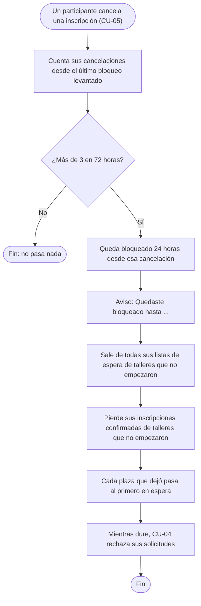

**Diagrama de secuencia**

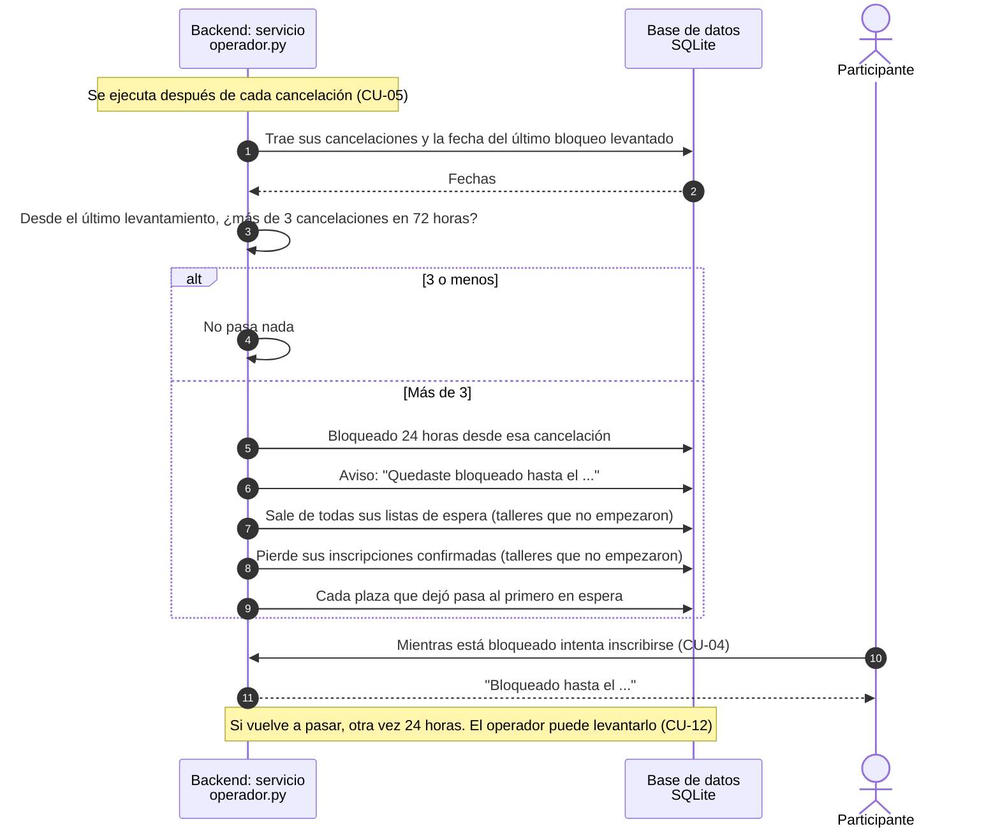

#### 5.2.2 CU-12 — Consultar el historial de cancelaciones y levantar un bloqueo

| Campo | Descripción |
|---|---|
| Actor | Operador |
| Objetivo | Ver cuándo canceló un participante, si está bloqueado y quitar el bloqueo |
| Disparador | Entra a «Historial de cancelaciones» y elige a un participante |
| Precondiciones | Inició sesión como operador |
| Poscondición de éxito | Ve las cancelaciones y el bloqueo. Si lo levanta, el participante puede volver a inscribirse y queda registrado qué operador lo levantó y cuándo |

**Flujo principal**

1. El operador elige al participante.
2. El sistema muestra sus cancelaciones (de la más reciente a la más antigua) y hasta cuándo está bloqueado.
3. Si está bloqueado, el operador puede presionar «Levantar bloqueo».
4. El sistema registra qué operador levantó el bloqueo y cuándo; el historial de cancelaciones se conserva completo y las cancelaciones anteriores ya no cuentan para un bloqueo.

**Rechazos y excepciones**

- E1. Sin cancelaciones: lista vacía.
- E2. Participante inexistente: 404.
- E3. Quien levanta no es operador: «Solo el operador puede hacer esta acción.»
- E4. No tiene un bloqueo activo: «El participante no tiene un bloqueo activo.»

**Diagrama de flujo**

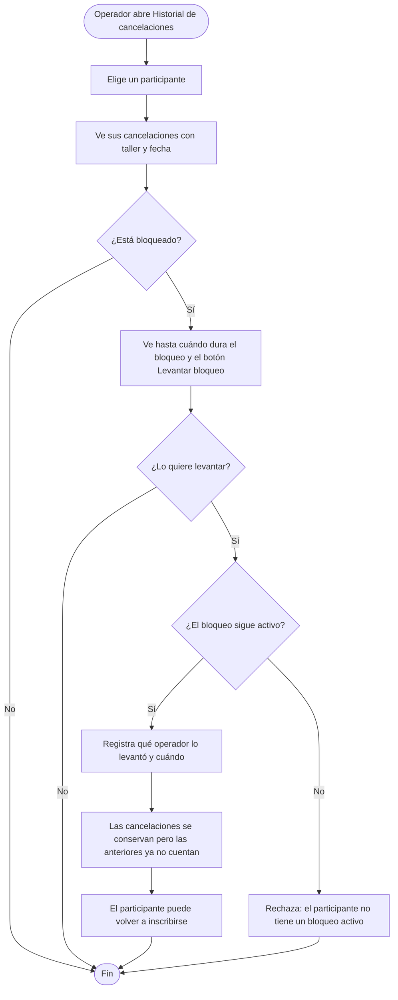

**Diagrama de secuencia**

```mermaid
sequenceDiagram
    autonumber
    actor OP as Operador
    participant Pan as Frontend<br/>Pantalla Historial de cancelaciones<br/>historial_cancelaciones.html
    participant Vis as Backend: vista<br/>historial / levantar_bloqueo<br/>views.py
    participant Ser as Backend: servicio<br/>operador.py
    participant BD as Base de datos<br/>SQLite

    OP->>Pan: Elige un participante y presiona "Ver historial"
    Pan->>Vis: Pide su historial
    Vis->>Ser: consultar_historial_cancelaciones y calcular_fin_del_bloqueo
    Ser->>BD: Busca sus cancelaciones y bloqueos
    BD-->>Vis: Cancelaciones y fecha de fin del bloqueo
    Vis-->>Pan: Muestra la lista
    Pan-->>OP: Cada cancelación con taller y fecha, y si está bloqueado
    opt Está bloqueado y el operador lo quiere levantar
        OP->>Pan: Presiona "Levantar bloqueo" y confirma
        Pan->>Vis: Envía el pedido
        Vis->>Ser: levantar_bloqueo(operador, participante)
        alt No tiene un bloqueo activo
            Ser-->>Vis: "El participante no tiene un bloqueo activo."
        else Tiene un bloqueo activo
            Ser->>BD: Registra quién levantó el bloqueo y cuándo
            Note over Ser,BD: No se borra ninguna cancelación.<br/>Las anteriores a este momento ya no cuentan para un nuevo bloqueo
            Ser-->>Vis: Bloqueo levantado
        end
        Vis-->>Pan: Vuelve al historial con el mensaje
        Pan-->>OP: El participante ya puede inscribirse
    end
```

### 5.3 HU-10 — Buscar inscripciones

**Historia de usuario:** Como operador, quiero buscar inscripciones por participante o por taller para responder consultas: qué talleres hay, si hay espacio, quiénes están inscritos y en qué orden espera cada uno.

- **Criterio de aceptación:** Se busca por código, usuario, nombre o apellido del participante, o por código o nombre del taller. Muestra taller, participante, estado y posición; con el código de un taller se ven sus confirmados, su espera en orden y sus cancelados. Sin texto no devuelve nada. No modifica datos.
- **Requisitos que cumple:** TAL-RF-14
- **Casos de uso:** CU-13
- **Pruebas:** `test_operador.py`, `test_buscar.py`

#### 5.3.1 CU-13 — Buscar inscripciones

| Campo | Descripción |
|---|---|
| Actor | Operador |
| Objetivo | Responder consultas sobre talleres, espacios, inscritos y orden de la espera |
| Disparador | Escribe en «Buscar inscripciones» |
| Precondiciones | Inició sesión como operador |
| Poscondición de éxito | Ve las inscripciones que coinciden; no se modifican datos |

**Flujo principal**

1. El operador escribe un código, nombre o apellido de participante, o un código o nombre de taller.
2. El sistema busca sin importar mayúsculas.
3. Muestra taller, participante, estado y posición. Con el código de un taller se ven sus confirmados, su espera en orden y sus cancelados.

**Rechazos y excepciones**

- E1. Sin texto: no muestra resultados.
- E2. Sin coincidencias: lista vacía.

**Diagrama de flujo**

```mermaid
flowchart TD
    A(["Operador abre Buscar inscripciones"]) --> B["Escribe un código, nombre o apellido, o un código o nombre de taller"]
    B --> C{"¿Escribió algo?"}
    C -- No --> D["Sin resultados"]
    C -- Sí --> E["Busca coincidencias sin importar mayúsculas"]
    E --> F{"¿Hay coincidencias?"}
    F -- No --> G["Lista vacía"]
    F -- Sí --> H["Muestra taller, participante, estado y posición"]
    D --> Z(["Fin"])
    G --> Z
    H --> Z
```

**Diagrama de secuencia**

```mermaid
sequenceDiagram
    autonumber
    actor OP as Operador
    participant Pan as Frontend<br/>Pantalla Buscar inscripciones<br/>buscar_inscripciones.html
    participant Vis as Backend: vista<br/>buscar_inscripciones<br/>views.py
    participant Ser as Backend: servicio<br/>operador.py
    participant BD as Base de datos<br/>SQLite

    OP->>Pan: Escribe un código o nombre de participante, o un código o nombre de taller
    Pan->>Vis: Envía la búsqueda
    alt No escribió nada
        Vis-->>Pan: Sin resultados
    else Escribió algo
        Vis->>Ser: buscar_inscripciones(texto)
        Ser->>BD: Busca inscripciones que coincidan (sin importar mayúsculas)
        BD-->>Ser: Coincidencias
        Ser-->>Vis: Resultados ordenados por fecha del taller
        Vis-->>Pan: Muestra la tabla
        Pan-->>OP: Taller, participante, estado y posición en la espera
    end
    Note over OP,Pan: Con el código de un taller (TAL-DAN-01) se ven sus confirmados,<br/>su espera en orden y sus cancelados
    Note over Vis,BD: Solo lee: no cambia ningún dato
```

## 6. Participante

El participante es el estudiante que se inscribe: busca talleres, pide su plaza, queda confirmado o en la lista de espera, cancela si no puede asistir y revisa el estado de sus inscripciones. Si cancela más de 3 veces en 72 horas, el sistema lo bloquea 24 horas.

```mermaid
flowchart LR
    PA["👤<br/>Participante"]
    subgraph S["Sistema de inscripciones a talleres"]
        subgraph GCM["De los tres roles"]
            CU03(["CU-03<br/>Ver y buscar talleres"])
            CU10(["CU-10<br/>Ver notificaciones"])
            CU15(["CU-15<br/>Crear cuenta e iniciar sesión"])
        end
        subgraph GPR["Propios del participante"]
            CU04(["CU-04<br/>Solicitar plaza"])
            CU05(["CU-05<br/>Cancelar una inscripción"])
            CU09(["CU-09<br/>Ver mis inscripciones"])
            CU11(["CU-11<br/>Bloquear por exceso de cancelaciones"])
        end
    end
    PA --- CU04
    PA --- CU05
    PA --- CU09
    CU05 -. "incluye" .-> CU11
    PA --- GCM
```

El bloqueo (CU-11) no lo pide nadie: el sistema lo aplica solo cuando el participante cancela (CU-05).

Historias de esta parte: HU-02 (solicitar una plaza), HU-05 (cancelar una inscripción), HU-08 (ver mis inscripciones), HU-11 (buscar talleres por categoría).

### 6.1 HU-02 — Solicitar una plaza

**Historia de usuario:** Como participante (o el operador a su nombre), quiero solicitar una plaza en un taller para asegurar mi cupo o quedar en la lista de espera.

- **Criterio de aceptación:** Con cupo libre queda Confirmado; con el taller lleno queda En espera en la última posición (máximo 20 % del cupo, redondeado hacia arriba). Se rechaza sin cambiar nada si no está en el padrón, está bloqueado, el taller está cancelado, no está aprobado o ya empezó, ya está inscrito en ese taller, tiene otro taller a la misma hora o taller y espera están llenos. Si había cancelado antes, entra como solicitud nueva. Dos pedidos a la vez nunca superan el cupo. Recibe un aviso con el resultado.
- **Requisitos que cumple:** TAL-RF-01, TAL-RF-02, TAL-RF-04, TAL-RF-05, TAL-RC-01
- **Casos de uso:** CU-04
- **Pruebas:** `test_operador.py`, `test_reinscripcion.py`, `test_simultaneas.py`, `test_sesion.py`, `e2e/test_recorridos.py`

Este es el flujo elegido para el detalle de la sesión 7. Además de la ficha, el diagrama de flujo y el de secuencia, incluye la tabla de estados de la inscripción (6.1.2).

#### 6.1.1 CU-04 — Solicitar plaza

| Campo | Descripción |
|---|---|
| Actor | Participante (o el Operador a su nombre) |
| Objetivo | Pedir una plaza en un taller |
| Disparador | Presiona «Solicitar inscripción» |
| Precondiciones | Inició sesión; el taller existe |
| Poscondición de éxito | Inscripción Confirmada (las ocupadas suben en 1) o En espera en la última posición; aviso con el resultado |

**Flujo principal**

1. El participante presiona «Solicitar inscripción» (el operador además elige al participante).
2. El sistema bloquea el taller hasta terminar, para que dos pedidos no tomen la misma plaza.
3. Verifica: está en el padrón, no está bloqueado, el taller no está cancelado, está aprobado y no empezó, no está inscrito en él y no tiene otro taller a la misma hora.
4. Si hay plazas libres, queda Confirmada.
5. Si no, y la espera tiene menos del 20 % del cupo, queda En espera en la última posición.
6. Si había cancelado antes en ese taller, reutiliza ese registro como solicitud nueva.
7. Guarda el aviso y muestra el estado y la posición.

**Rechazos y excepciones**

- E1. No está en el padrón.
- E2. Bloqueado: «Bloqueado hasta el dd/mm HH:MM…»
- E3. Taller cancelado, no aprobado o ya empezado.
- E4. Ya inscrito en ese taller: «El participante ya se encuentra registrado en el taller …»
- E5. Otro taller a la misma hora: «El participante ya tiene otro taller en este horario.»
- E6. Taller lleno pero la espera tiene lugar: no es un error, queda En espera en la última posición.
- E7. Taller y espera llenos: «El taller y la lista de espera están llenos.»
- E8. El operador no eligió participante: «Elige un participante de la lista.»
- En todos los rechazos no se guarda nada.

**Diagrama de flujo**

```mermaid
flowchart TD
    A(["Participante presiona Solicitar inscripción"]) --> B["El sistema bloquea el taller hasta terminar"]
    B --> C{"¿Figura en el padrón?"}
    C -- No --> R1["E1: Rechaza, no figura en la lista de estudiantes"]
    C -- Sí --> D{"¿Está bloqueado por cancelaciones?"}
    D -- Sí --> R2["E2: Rechaza, bloqueado hasta ..."]
    D -- No --> E{"¿Taller cancelado, no aprobado o ya empezó?"}
    E -- Sí --> R3["E3: Rechaza con el motivo"]
    E -- No --> F{"¿Ya tiene inscripción activa en este taller?"}
    F -- Sí --> R4["E4: Rechaza, ya se encuentra registrado"]
    F -- No --> G{"¿Otro taller confirmado o en espera a la misma hora?"}
    G -- Sí --> R5["E5: Rechaza, ya tiene otro taller en este horario"]
    G -- No --> H{"¿Hay plazas libres?"}
    H -- Sí --> I["Guarda CONFIRMADA y avisa"]
    H -- No --> J{"¿La espera tiene menos del 20 % del cupo?"}
    J -- Sí --> K["E6: Guarda EN ESPERA al final de la fila y avisa"]
    J -- No --> R6["E7: Rechaza, el taller y la lista de espera están llenos"]
    I --> Z(["Fin"])
    K --> Z
    R1 --> Z
    R2 --> Z
    R3 --> Z
    R4 --> Z
    R5 --> Z
    R6 --> Z
```

**Diagrama de secuencia**

```mermaid
sequenceDiagram
    autonumber
    actor P as Participante
    participant Pan as Frontend<br/>Pantalla Solicitar inscripción<br/>solicitar_inscripcion.html
    participant Vis as Backend: vista<br/>solicitar_inscripcion<br/>views.py
    participant Ser as Backend: servicio<br/>operador.py
    participant BD as Base de datos<br/>SQLite

    P->>Pan: Presiona "Solicitar inscripción"
    Pan->>Vis: Envía el pedido
    Vis->>Ser: registrar_inscripcion(participante, taller)
    Ser->>BD: Bloquea el taller (si llega otro pedido, espera su turno)
    Ser->>Ser: Revisa las reglas en orden
    Note right of Ser: E1 ¿Está en el padrón?<br/>E2 ¿Está bloqueado?<br/>E3 ¿Taller cancelado, no aprobado o ya empezó?<br/>E4 ¿Ya está inscrito en este taller?<br/>E5 ¿Tiene otro taller a la misma hora?
    alt Falla alguna regla (E1 a E5)
        Ser-->>Vis: Error con el motivo
        Vis-->>Pan: Muestra el error
        Pan-->>P: No se guarda nada
    else Hay plazas libres
        Ser->>BD: Guarda la inscripción CONFIRMADA
        Ser->>BD: Aviso: "Quedaste inscrito"
        Ser-->>Vis: Inscripción confirmada
        Vis-->>Pan: Muestra el resultado
        Pan-->>P: Estado: Confirmado
    else E6: Taller lleno y la espera tiene lugar (20 % del cupo)
        Ser->>BD: Guarda la inscripción EN ESPERA al final de la fila
        Ser->>BD: Aviso: "Estás en la lista de espera, posición N"
        Ser-->>Vis: Inscripción en espera
        Vis-->>Pan: Muestra el resultado
        Pan-->>P: Estado: En espera, posición N
    else E7: Taller y espera llenos
        Ser-->>Vis: "El taller y la lista de espera están llenos."
        Vis-->>Pan: Muestra el error
        Pan-->>P: No se guarda nada
    end
```

#### 6.1.2 Estados de la inscripción

Muestra cómo cambia el estado de **una inscripción de una persona en un taller** (no del taller completo).

| Estado actual | Evento y condición | Estado siguiente | Efecto sobre los datos |
|---|---|---|---|
| Sin inscripción | Solicita y hay plazas libres | Confirmada | Se crea la inscripción; las ocupadas suben en 1; se guarda el aviso. |
| Sin inscripción | Solicita, taller lleno y espera con lugar | En espera | Se crea con la última posición; las ocupadas no cambian. |
| Sin inscripción | Solicita y se rechaza | Sin inscripción | No se guarda nada. |
| Confirmada o En espera | Vuelve a solicitar el mismo taller | Igual que antes | Se rechaza; sigue una sola inscripción activa. |
| En espera | Se libera una plaza (cancelación o aumento de cupo) | Confirmada | Pierde la posición; los demás avanzan; recibe «Felicidades…». |
| Confirmada o En espera | Cancela al menos 3 horas antes | Cancelada | Se guarda en el historial; si era confirmada, el primero en espera pasa a confirmado. |
| Confirmada o En espera | Queda bloqueado o se cancela el taller | Cancelada | Por bloqueo, su plaza pasa al siguiente en espera. Por taller cancelado, no cuenta en su historial. |
| Cancelada | Vuelve a solicitar el mismo taller | Confirmada o En espera | Se reutiliza el mismo registro como solicitud nueva; no recupera su posición anterior. |

«Sin inscripción» es la ausencia de un registro activo, no un valor guardado. Un rechazo no crea un estado «rechazada»: lo que se rechaza es la **solicitud**.

### 6.2 HU-05 — Cancelar una inscripción

**Historia de usuario:** Como participante (o el operador a su nombre), quiero cancelar mi inscripción o mi lugar en la lista de espera para liberar el cupo para otro compañero si ya no puedo asistir.

- **Criterio de aceptación:** Se acepta hasta 3 horas antes del inicio (taller a las 12:00: a las 8:30 sí, a las 9:30 no). Queda Cancelado, se guarda en el historial y recibe aviso. Si estaba Confirmado, el primero en espera pasa a Confirmado sin aceptar, recibe «Felicidades, se liberó una plaza…» y los demás avanzan. Repetir la cancelación no cambia nada. El participante solo cancela lo suyo.
- **Requisitos que cumple:** TAL-RF-03, TAL-RF-06
- **Casos de uso:** CU-05
- **Pruebas:** `test_operador.py`, `test_cancelar.py`, `test_notificaciones.py`, `e2e/test_recorridos.py`

#### 6.2.1 CU-05 — Cancelar una inscripción

| Campo | Descripción |
|---|---|
| Actor | Participante (o el Operador a su nombre) |
| Objetivo | Retirar una inscripción o un lugar en la espera y liberar la plaza |
| Disparador | Presiona «Cancelar» en «Mis inscripciones» |
| Precondiciones | Inició sesión; la inscripción es suya (o es operador) |
| Poscondición de éxito | Inscripción Cancelada, en el historial y con aviso; si estaba Confirmada, el primero en espera pasa a Confirmado; la espera se renumera |

**Flujo principal**

1. El usuario presiona «Cancelar» y confirma.
2. El sistema verifica que falten al menos 3 horas para el inicio.
3. Pasa la inscripción a Cancelada, la guarda en el historial y avisa.
4. Si estaba Confirmada, confirma al primero en espera y le avisa «Felicidades…».
5. Renumera la espera.
6. Revisa si con esta cancelación queda bloqueado (CU-11).

**Rechazos y excepciones**

- E1. Faltan menos de 3 horas: «Ya pasó el tiempo límite para cancelar.»
- E2. Cancelación repetida: «No existe inscripción activa para cancelar.»
- E3. Inscripción de otra persona (participante): 403.

**Diagrama de flujo**

```mermaid
flowchart TD
    A(["Participante presiona Cancelar y confirma"]) --> B{"¿Faltan al menos 3 horas para el inicio?"}
    B -- No --> R1["Rechaza: ya pasó el tiempo límite para cancelar"]
    B -- Sí --> C{"¿Tiene una inscripción confirmada o en espera?"}
    C -- No --> R2["Rechaza: no existe inscripción activa para cancelar"]
    C -- Sí --> D["Inscripción CANCELADA, guardada en el historial y con aviso"]
    D --> E{"¿Estaba confirmada y hay gente en espera?"}
    E -- Sí --> F["El primero de la espera pasa a CONFIRMADO y recibe aviso"]
    E -- No --> G["Nadie cambia de estado"]
    F --> H["La espera se renumera sin huecos"]
    G --> H
    H --> I{"¿Más de 3 cancelaciones en 72 horas?"}
    I -- Sí --> J["Se aplica el bloqueo (CU-11)"]
    I -- No --> Z(["Fin"])
    J --> Z
    R1 --> Z
    R2 --> Z
```

**Diagrama de secuencia**

```mermaid
sequenceDiagram
    autonumber
    actor P as Participante
    participant Pan as Frontend<br/>Pantalla Mis inscripciones<br/>mis_inscripciones.html
    participant Vis as Backend: vista<br/>cancelar_inscripcion<br/>views.py
    participant Ser as Backend: servicio<br/>operador.py
    participant BD as Base de datos<br/>SQLite

    P->>Pan: Presiona "Cancelar" y confirma
    Pan->>Vis: Envía la cancelación
    Vis->>Ser: cancelar_inscripcion(participante, taller)
    alt Faltan menos de 3 horas para el inicio
        Ser-->>Vis: "Ya pasó el tiempo límite para cancelar."
    else Ya estaba cancelada
        Ser-->>Vis: "No existe inscripción activa para cancelar."
    else Se puede cancelar
        Ser->>BD: Inscripción = CANCELADA
        Ser->>BD: Guarda la cancelación en el historial
        Ser->>BD: Aviso: "Cancelaste tu inscripción"
        opt Estaba CONFIRMADA y hay gente en espera
            Ser->>BD: El primero de la espera pasa a CONFIRMADO
            Ser->>BD: Aviso a esa persona: "Felicidades, se liberó una plaza"
        end
        Ser->>BD: Los demás de la espera suben un puesto
        Ser->>Ser: ¿Ya canceló más de 3 veces en 72 horas? (CU-11)
        Ser-->>Vis: Cancelación lista
    end
    Vis-->>Pan: Vuelve a Mis inscripciones con el mensaje
    Pan-->>P: Ve su inscripción cancelada
```

### 6.3 HU-08 — Ver mis inscripciones

**Historia de usuario:** Como participante, quiero consultar el estado de mis inscripciones para saber si tengo lugar confirmado o en qué posición de la espera estoy.

- **Criterio de aceptación:** Muestra cada taller con su estado (Confirmado, En espera, Cancelado), la posición si espera y el botón Cancelar mientras se pueda. Solo ve las suyas, del taller más próximo al más lejano. El operador puede elegir a un participante y ver las de él.
- **Requisitos que cumple:** TAL-RF-14
- **Casos de uso:** CU-09
- **Pruebas:** `test_participante.py`

#### 6.3.1 CU-09 — Ver mis inscripciones

| Campo | Descripción |
|---|---|
| Actor | Participante (también Operador) |
| Objetivo | Saber en qué estado está cada inscripción |
| Disparador | Entra a «Mis inscripciones» |
| Precondiciones | Inició sesión |
| Poscondición de éxito | Ve las inscripciones; no se modifican datos |

**Flujo principal**

1. El sistema obtiene las inscripciones del participante (el operador elige primero a quién), del taller más próximo al más lejano.
2. Muestra taller, fechas, estado y posición si espera.
3. Muestra «Cancelar» en las que todavía se pueden cancelar (CU-05).

**Rechazos y excepciones**

- E1. Sin inscripciones: lista vacía.

**Diagrama de flujo**

```mermaid
flowchart TD
    A(["Participante abre Mis inscripciones"]) --> B["Busca sus inscripciones por fecha del taller"]
    B --> C{"¿Tiene inscripciones?"}
    C -- No --> D["Muestra la lista vacía"]
    C -- Sí --> E["Muestra taller, fechas, estado y posición en la espera"]
    E --> F{"¿La inscripción está activa y el taller no empezó?"}
    F -- Sí --> G["Muestra el botón Cancelar (CU-05)"]
    F -- No --> H["Sin botón"]
    D --> Z(["Fin"])
    G --> Z
    H --> Z
```

**Diagrama de secuencia**

```mermaid
sequenceDiagram
    autonumber
    actor P as Participante
    participant Pan as Frontend<br/>Pantalla Mis inscripciones<br/>mis_inscripciones.html
    participant Vis as Backend: vista<br/>mis_inscripciones<br/>views.py
    participant BD as Base de datos<br/>SQLite

    P->>Pan: Abre "Mis inscripciones"
    Pan->>Vis: Pide sus inscripciones
    Vis->>BD: Busca las inscripciones de esta persona, por fecha del taller
    BD-->>Vis: Inscripciones
    alt No tiene ninguna
        Vis-->>Pan: Lista vacía
    else Tiene inscripciones
        Vis-->>Pan: Lista con estado y posición
        Pan-->>P: Taller, fechas, estado (Confirmado, En espera o Cancelado) y posición
        Pan-->>P: Botón "Cancelar" en las que todavía puede cancelar
    end
    Note over Vis,BD: El operador puede elegir a un participante y ver sus inscripciones
```

### 6.4 HU-11 — Buscar talleres por categoría

**Historia de usuario:** Como participante, quiero buscar talleres por categoría para encontrar rápido los del tipo que me interesa.

- **Criterio de aceptación:** Al elegir una categoría se ven solo sus talleres; con «Todas», todos. Solo aparecen talleres aprobados, no cancelados y que no empezaron. Las categorías (Deporte, Canto, Danza, Artes Marciales, Literatura) las amplía el operador, sin vacíos ni repetidos.
- **Requisitos que cumple:** TAL-RF-12
- **Casos de uso:** CU-03, CU-14
- **Pruebas:** `test_participante.py`, `test_catalogos_operador.py`

#### 6.4.1 CU-03 — Ver y buscar talleres

Este caso de uso también sirve a HU-11. Su ficha y sus diagramas están en la sección 4.1.2.

#### 6.4.2 CU-14 — Agregar categorías y motivos de edición

Este caso de uso también sirve a HU-11. Su ficha y sus diagramas están en la sección 4.2.2.

## 7. Funciones compartidas

Estas historias las usan los tres roles: entrar al sistema (y crear la cuenta si es estudiante) y ver los avisos en pantalla.

```mermaid
flowchart LR
    CO["👤<br/>Coordinador"]
    OP["👤<br/>Operador"]
    PA["👤<br/>Participante"]
    subgraph S["Sistema de inscripciones a talleres"]
        CU15(["CU-15<br/>Crear cuenta e iniciar sesión"])
        CU10(["CU-10<br/>Ver notificaciones"])
    end
    CO --- CU15
    CO --- CU10
    OP --- CU15
    OP --- CU10
    PA --- CU15
    PA --- CU10
```

Historias de esta parte: HU-06 (ver los avisos en pantalla), HU-12 (crear cuenta e iniciar sesión).

### 7.1 HU-06 — Ver los avisos en pantalla

**Historia de usuario:** Como participante (también coordinador), quiero ver en pantalla los avisos de lo que cambió para enterarme sin que me envíen mensajes por fuera.

- **Criterio de aceptación:** Solo en pantalla (decisión del cliente): inscripción, espera, promoción, cancelación, bloqueo, taller cancelado, vuelta al horario original y aprobación o rechazo de talleres. El más nuevo primero; los no leídos aparecen como «Nuevo:» y al abrir la pantalla quedan leídos.
- **Requisitos que cumple:** TAL-RF-13
- **Casos de uso:** CU-10
- **Pruebas:** `test_notificaciones.py`

#### 7.1.1 CU-10 — Ver notificaciones

| Campo | Descripción |
|---|---|
| Actor | Participante, Coordinador u Operador |
| Objetivo | Enterarse de los cambios que lo afectan |
| Disparador | Entra a «Notificaciones» |
| Precondiciones | Inició sesión |
| Poscondición de éxito | Ve sus avisos y quedan marcados como leídos |

**Flujo principal**

1. El sistema obtiene los avisos del usuario, el más nuevo primero.
2. Los muestra con fecha, taller y mensaje; los no leídos con «Nuevo:».
3. Los marca como leídos.

**Rechazos y excepciones**

- E1. Sin avisos: «No tienes notificaciones.»

**Diagrama de flujo**

```mermaid
flowchart TD
    A(["Usuario abre Notificaciones"]) --> B["Busca sus avisos, el más nuevo primero"]
    B --> C{"¿Tiene avisos?"}
    C -- No --> D["Muestra: No tienes notificaciones"]
    C -- Sí --> E["Muestra fecha, taller y mensaje, los nuevos con la palabra Nuevo"]
    E --> F["Marca todos como leídos"]
    D --> Z(["Fin"])
    F --> Z
```

**Diagrama de secuencia**

```mermaid
sequenceDiagram
    autonumber
    actor U as Usuario
    participant Pan as Frontend<br/>Pantalla Notificaciones<br/>notificaciones.html
    participant Vis as Backend: vista<br/>notificaciones<br/>views.py
    participant Ser as Backend: servicio<br/>notificaciones.py
    participant BD as Base de datos<br/>SQLite

    U->>Pan: Abre "Notificaciones"
    Pan->>Vis: Pide sus avisos
    Vis->>Ser: listar_notificaciones(usuario)
    Ser->>BD: Busca sus avisos, el más nuevo primero
    BD-->>Vis: Avisos
    Vis->>Ser: marcar_todas_como_leidas(usuario)
    Ser->>BD: Marca los avisos como leídos
    alt No tiene avisos
        Vis-->>Pan: "No tienes notificaciones."
    else Tiene avisos
        Vis-->>Pan: Lista de avisos
        Pan-->>U: Fecha, taller y mensaje (los nuevos dicen "Nuevo:")
    end
    Note over U,BD: Los avisos solo se ven en pantalla, como pidió el cliente
```

### 7.2 HU-12 — Crear cuenta e iniciar sesión

**Historia de usuario:** Como usuario (estudiante, coordinador u operador), quiero crear mi cuenta si soy estudiante, entrar con mi código y contraseña y ver solo las opciones de mi rol para que nadie haga acciones que no le corresponden.

- **Criterio de aceptación:** Solo un código del padrón sin cuenta puede registrarse (queda como Participante). Con datos incorrectos siempre: «El código o la contraseña no coinciden.». Cada rol va a su pantalla y ve solo su menú; sin sesión va a Entrar; con otro rol, 403 aunque escriba la dirección.
- **Requisitos que cumple:** TAL-RF-09
- **Casos de uso:** CU-15
- **Pruebas:** `test_sesion.py`, `test_registro.py`, `test_login_redireccion.py`, `test_permisos.py`, `e2e/test_recorridos.py`

#### 7.2.1 CU-15 — Crear cuenta e iniciar sesión

| Campo | Descripción |
|---|---|
| Actor | Estudiante, Participante, Coordinador u Operador |
| Objetivo | Entrar al sistema y ver solo lo de su rol |
| Disparador | Elige «Registrarse» o abre cualquier pantalla sin sesión |
| Precondiciones | Para registrarse: su código está en el padrón. Para entrar: tiene cuenta activa |
| Poscondición de éxito | Sesión iniciada y pantalla de inicio según el rol (o la página pedida, si es de este sitio) |

**Flujo principal**

Registro:
1. El estudiante escribe su código y dos veces la contraseña.
2. El sistema verifica que sean iguales, que el código esté en el padrón y no tenga cuenta, y que la contraseña sea segura.
3. Crea la cuenta como Participante con nombre y apellido del padrón e inicia la sesión.
Inicio de sesión:
4. El usuario escribe código y contraseña.
5. El sistema los comprueba e inicia la sesión.
6. Lo lleva a su pantalla: participante → Mis inscripciones, coordinador → Crear taller, operador → Talleres.

**Rechazos y excepciones**

- E1. Contraseñas distintas, código fuera del padrón, ya tiene cuenta o contraseña débil: muestra el motivo y no crea nada.
- E2. Código o contraseña incorrectos: «El código o la contraseña no coinciden.»
- E3. Enlace «next» a otro sitio: lo ignora.
- E4. Pantalla de otro rol: 403.

**Diagrama de flujo**

```mermaid
flowchart TD
    A(["Persona abre el sistema"]) --> B{"¿Tiene cuenta?"}
    B -- No --> C["Registrarse: código y dos veces la contraseña"]
    C --> D{"¿Contraseñas iguales, código en el padrón, sin cuenta previa y contraseña segura?"}
    D -- No --> R1["Muestra el motivo y no crea nada"]
    D -- Sí --> E["Crea la cuenta como Participante e inicia la sesión"]
    B -- Sí --> F["Entrar: código y contraseña"]
    F --> G{"¿Código y contraseña correctos?"}
    G -- No --> R2["El código o la contraseña no coinciden"]
    G -- Sí --> H{"¿Qué rol tiene?"}
    H -- Participante --> I["Va a Mis inscripciones"]
    H -- Coordinador --> J["Va a Crear taller"]
    H -- Operador --> K["Va a Talleres"]
    E --> I
    I --> Z(["Fin"])
    J --> Z
    K --> Z
    R1 --> Z
    R2 --> Z
```

**Diagrama de secuencia**

```mermaid
sequenceDiagram
    autonumber
    actor U as Estudiante o usuario
    participant Pan as Frontend<br/>Pantalla Registrarse / Entrar<br/>registro.html y login.html
    participant Vis as Backend: vista<br/>registrarse / iniciar_sesion<br/>views.py
    participant Ser as Backend: servicio<br/>participante.py / sesion.py
    participant BD as Base de datos<br/>SQLite

    opt Crear cuenta (solo estudiantes)
        U->>Pan: Escribe su código y dos veces la contraseña
        Pan->>Vis: Envía el registro
        Vis->>Ser: registrar_cuenta(código, contraseña)
        Ser->>BD: ¿El código está en el padrón? ¿Ya tiene cuenta?
        alt No está en el padrón, ya tiene cuenta o la contraseña es débil
            Ser-->>Vis: Error con el motivo
        else Todo bien
            Ser->>BD: Crea la cuenta como Participante
            Vis-->>Pan: Entra directo a Mis inscripciones
        end
    end
    opt Iniciar sesión
        U->>Pan: Escribe su código y contraseña
        Pan->>Vis: Envía los datos
        Vis->>Ser: iniciar_sesion(código, contraseña)
        Ser->>BD: Busca la cuenta y revisa la contraseña
        alt Datos incorrectos
            Ser-->>Vis: "El código o la contraseña no coinciden."
        else Correctos
            Ser-->>Vis: Usuario y pantalla de su rol
            Vis-->>Pan: Participante → Mis inscripciones, Coordinador → Crear taller, Operador → Talleres
        end
    end
    Note over U,BD: Cada rol ve solo su menú. Si escribe la dirección de otra pantalla recibe 403
```

## 8. Trazabilidad del flujo elegido (HU-02 / CU-04)

| Requisito | Paso o rama del diagrama de flujo | Escenario de la sesión 6 y prueba |
|---|---|---|
| TAL-RF-01 | «¿Hay plazas libres? Sí» | Normal: `TAL-DAN-01` 5/10, P-01 queda confirmado → `test_confirmado_con_plaza_libre`. Taller empezado → `test_e1_taller_ya_iniciado_no_escribe_nada` |
| TAL-RF-02 | «¿La espera tiene menos del 20 %?» | Límite: 20/20 y espera 4/4 → `test_e4_espera_en_ultima_posicion`, `test_e5_taller_y_espera_llenos_rechaza_sin_cambios` |
| TAL-RF-04 | «¿Hay plazas libres?» (reutiliza el registro cancelado) | `test_reinscripcion.py` |
| TAL-RF-05 | «¿Otro taller a la misma hora? Sí» | Rechazo: P-01 en `TAL-DAN-01` pide `TAL-FUT-01` → `test_e3_choque_de_horario_conserva_la_inscripcion_previa` |
| TAL-RF-08 | «¿Está bloqueado? Sí» | `test_baneo.py` |
| TAL-RF-09 | «¿Taller cancelado, no aprobado o ya empezó? Sí» | `test_operador_aprueba_un_taller_pendiente_y_recien_ahi_acepta_inscripciones` |
| TAL-RC-01 | «El sistema bloquea el taller hasta terminar» | `test_simultaneas.py` |
| Duplicado (TAL-04) | «¿Ya tiene inscripción activa? Sí» | `test_duplicado_rechazado_sin_cambios` |

## 9. Revisión

- **Revisión por otro equipo:** no se hizo revisión con otro equipo (la actividad era opcional).
- **Escenarios recorridos internamente:** normal (`TAL-DAN-01` 5/10), límite (20/20 con espera 4/4) y rechazo por choque de horario.
- **Observación:** la primera versión ponía «no tener más de 3 cancelaciones en 72 horas» como **precondición** de CU-04. Así la ruta de rechazo por bloqueo nunca podía ocurrir.
- **Corrección:** el bloqueo pasó a ser una comprobación dentro del flujo (E2). Además, el choque de horario ahora cuenta también las inscripciones en espera.

## 10. Cambios en los requisitos

| Requisito | Cambio | Confirmación del cliente | Efecto en los modelos |
|---|---|---|---|
| TAL-RF-08 | El bloqueo pasó de provisional a regla completa: 24 h, pierde todo, el operador puede levantarlo, reincidencia igual | 22/10 | Se agregan CU-11 y CU-12 |
| TAL-RF-08 | Al levantar un bloqueo se conserva todo el historial y se registra quién lo levantó y cuándo | Cliente | CU-12 registra el levantamiento en lugar de borrar cancelaciones |
| TAL-RF-09 | Roles, inicio de sesión y aprobación de talleres; se quita el rol Instructor | Reunión 02 | Se agregan CU-02 y CU-15; nueva rama E3 en CU-04 |
| TAL-RF-13 | Los avisos solo se muestran en pantalla | 22/10 | Se agrega CU-10 |
| TAL-RF-07 | Al reducir el cupo, no puede quedar por debajo de los confirmados | 22/10 | Rechazo en CU-06 |
| TAL-RF-02 | El 20 % se redondea hacia arriba | Cliente | Cupo 12 → espera de 3; cupo 4 → espera de 1 |
| TAL-RT-02 | El código pasa de `DAN-PAR-01` a `TAL-DAN-01` | Reunión 02 | CU-01 arma el código nuevo |
| TAL-RT-03 | Cupo entre 4 y 40 | Reunión 02 | Validación en CU-01 y CU-06 |

Estos cambios también están en [sesion-06-requisitos.md](sesion-06-requisitos.md).

## 11. Siguiente paso y participación

- **Siguiente paso:** presentar al cliente el incremento final, recorriendo el flujo de CU-04 con los escenarios normal, límite y rechazo de la sesión 6, y mostrar la suite de pruebas pasando en `main`.
- **Aportes de cada integrante:** los tres redactaron historias y casos de uso de su parte del sistema y revisaron el flujo elegido con los escenarios de la sesión 6.
- **Asistencia de IA:** se usó un asistente de IA para contrastar las historias, los casos de uso y los diagramas con el código. Cada regla y cada mensaje se comprobó en `inscripciones/servicios/` y ejecutando las pruebas.
