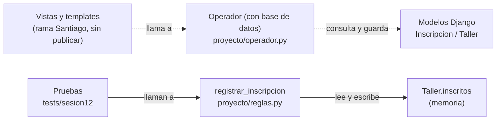

# Sesión 12 — Arquitectura y verificación del flujo

- Proyecto e integrantes: P03 — Inscripciones a talleres y listas de espera; Gonzalo Cárdenas, Santiago Arauz y Andrea Trujillo.
- Fecha real de la actividad: 13 de octubre de 2026.
- Requisitos: [Sesión 6](sesion-06-requisitos.md).
- Modelos: [Sesión 7](sesion-07-modelos.md).
- Plan: [Sesiones 8–9](sesion-08-09-plan.md).
- Operación seleccionada: solicitar inscripción a un taller (`registrar_inscripcion`).
- IDs vigentes y estado de aprobación: `TAL-HU-01`, `TAL-CU-01`, `TAL-MOD-01`; `TAL-RF-01` (aprobado por el cliente); `TAL-RF-02` (aprobado, redondeo del 20 % pendiente, ENT-07).
- Tarea/issue que continúa: tareas C (pruebas) y D (integrar y ejecutar) del plan de las sesiones 8–9 ([sesion-08-09-plan.md](sesion-08-09-plan.md)). No tenemos una tarjeta o issue aparte para esta tarea.
- Retroalimentación que atiende, si existe: Ninguna.

## 1. Punto de partida y alcance

- Qué ya funcionaba y con qué evidencia: la función `registrar_inscripcion` de `proyecto/reglas.py` en `main` (commit `6c7fadd`) y 7 pruebas en `tests/test_reglas.py`. Se ejecutaron antes de empezar y pasaron las 7.
- Problema o brecha que abordamos:
  - Las pruebas que ya había no comparan los datos contra una copia anterior, y los casos no usan los mismos datos (taller de cupo 2) en los tres escenarios.
  - El código de `main` solo implementa duplicado, cupo y espera. No implementa hora de inicio, choque de horario ni el límite del 20 %. Esas reglas están escritas en la clase `Operador` (usa la base de datos de Django) de las ramas `andrea` y `gonzalo`, sin pruebas y sin estar en `main`.
- Incluimos hoy: tres pruebas sobre `registrar_inscripcion` (aceptación, repetición, límite), el workflow de CI y este documento. No cambiamos el código de las reglas.
- Queda pendiente: la lista de espera no se guarda, el límite del 20 %, hora de inicio, choque de horario, cancelaciones y la conexión con Django.
- Comando y resultado inicial real: `python -m pytest -q` sobre `main` (commit `6c7fadd`) → **7 aprobadas, 0 fallidas** (Python 3.13, pytest 8.4.2; ejecutado antes de agregar las pruebas nuevas).

## 2. Responsabilidades y dependencias

| Grupo/componente | Responsabilidad | Código existente o propuesto | Usa qué interfaz de otro grupo |
|---|---|---|---|
| Interfaz web (vistas, formulario, urls y templates) | Recibir la solicitud del participante y mostrar la respuesta | `inscripciones/views.py` (`lista_talleres`, `crear_taller`, `solicitar_inscripcion`, `resultado_inscripcion`), `forms.py`, `urls.py` y los templates `solicitar_inscripcion.html` y `resultado_inscripcion.html`. **En desarrollo en la rama `Santiago`, todavía sin publicar ni integrar en `main`.** | `Operador.registrar_inscripcion(participante, taller)` de `proyecto/operador.py`: la llama `solicitar_inscripcion`, que captura `ValidationError` y redirige a `resultado_inscripcion` |
| Reglas de inscripción en memoria | Decidir si la solicitud es confirmada, queda en espera o se rechaza | `proyecto/reglas.py`: `registrar_inscripcion` y `crear_taller`. **Implementado** en `main` | Lee y escribe `Taller.inscritos` |
| Reglas con base de datos (`Operador`) | Las mismas decisiones, más hora de inicio, choque de horario y límite del 20 %, consultando los modelos de Django | `proyecto/operador.py`: `Operador.registrar_inscripcion`. **Existe en las ramas `andrea`, `gonzalo` y `Santiago`; no está en `main` y no tiene pruebas** | `Inscripcion.objects` (modelos Django) |
| Datos del taller | Guardar el cupo y los inscritos confirmados | Clase `Taller` en `proyecto/reglas.py` (lista `inscritos` en memoria). **Implementado**. Modelos Django `Taller` e `Inscripcion` en la rama `gonzalo`. **Propuesto** (no está en `main`) | Ninguna |

- Cohesión: todo lo que hay en `reglas.py` tiene un propósito: crear talleres y decidir inscripciones. La función `registrar_inscripcion` no pide datos ni imprime; solo decide.
- Acoplamiento: quien llama a la función (vistas y pruebas) conoce que el resultado es un diccionario con las claves `id_participante`, `estado` y `mensaje`, y que los inscritos son una lista en `taller.inscritos`. Si los datos pasan a la base de datos, esos detalles cambian y afectan a las vistas y a las pruebas.
- Mezcla encontrada o frontera que ya estaba separada: en `main`, la regla ya está separada de `input()`/`print()` y de la base de datos (el `print` solo está en el bloque `if __name__ == "__main__"`). En cambio, en `Operador.registrar_inscripcion` las reglas (taller iniciado, choque de horario) hacen consultas a la base (`Inscripcion.objects.filter(...)`) dentro de la misma función, así que están mezcladas. Además, la vista `solicitar_inscripcion` calcula por su cuenta `int(taller.cupo_maximo * porcentaje_lista_espera)` y cuenta inscritos con consultas directas a `Inscripcion`; o sea, repite el límite del 20 % que ya está en `Operador`.

## 3. Interfaz seleccionada

- Proveedor y consumidor: `proyecto/reglas.py` (proveedor); las pruebas y, a futuro, las vistas de Django (consumidores).
- Operación y firma real: `registrar_inscripcion(taller: Taller, ci_participante: str) -> dict` (implementada).
- Entradas: un `Taller` con `cupo_maximo` e `inscritos`, y el CI del participante como texto. Se supone que el participante ya está identificado.
- Resultado aceptado: devuelve `{"id_participante", "estado": "CONFIRMADO", "mensaje"}` y agrega ese mismo registro al final de `taller.inscritos`.
- Resultado de rechazo/repetición:
  - Si el CI ya está en `inscritos`: lanza `ValueError` («ya está inscrito en este taller») y no cambia nada.
  - Si el cupo está lleno: devuelve un registro con `estado: "EN_ESPERA"` y no modifica `inscritos`.
- Datos que deben conservarse: la lista `inscritos` completa con sus registros, y el id, nombre, categoría y cupo del taller. El contrato de esta sesión no incluye la lista de espera, porque el código no la guarda.
- Consulta y escritura: la misma función consulta `taller.inscritos` y escribe con `append`. Todavía no hay una capa de datos separada.
- Restricción de uso/importación para pruebas: el módulo solo importa `uuid`. No pide teclado ni usa base de datos, y el bloque con `print` no se ejecuta al importar. Las pruebas crean el taller con `crear_taller`.

## 4. Vistas del mismo flujo

### Responsabilidades y dependencias

- Las flechas significan: «depende de» o «llama a» (quien está en el origen necesita al que está en la punta). No muestran el flujo de datos.
- Lo ya implementado y lo propuesto se distinguen mediante: línea continua = implementado en `main`; línea punteada = existe solo en ramas, sin publicar o sin probar.
- Pregunta que responde esta vista: ¿qué parte llama a qué, y qué código está realmente cubierto por las pruebas de hoy? Hoy cubren `reglas.py` (lado derecho); la ruta de las vistas y `Operador` (lado izquierdo) no está probada.

### Ejecución: éxito y rechazo

- Modelo reutilizado: [Sesión 7, TAL-CU-01 y TAL-MOD-01](sesion-07-modelos.md) (flujo principal y E4).
- Recorrido de éxito:
  1. Recibe el taller y el CI.
  2. Busca el CI en `taller.inscritos`; no está.
  3. Compara `len(inscritos) < cupo_maximo`; hay plaza.
  4. Crea el registro con estado `CONFIRMADO` y su mensaje.
  5. Lo agrega a `taller.inscritos` (escritura en memoria).
  6. Devuelve el registro.
- Recorrido de rechazo/repetición:
  - Repetición: se decide en el paso 2. El CI ya existe, lanza `ValueError` y `inscritos` queda igual.
  - Cupo lleno: se decide en el paso 3. Devuelve `EN_ESPERA` y no escribe nada.
- Cambio realizado al modelo anterior, si correspondió: ninguno. Solo anotamos que `reglas.py` en `main` no tiene los pasos de hora de inicio (2), cancelaciones (3) y choque de horario (4) del modelo de la sesión 7, ni el rechazo E5. La hora de inicio, el choque y E5 están en `Operador`, sin probar. El control de cancelaciones (E2) no está en ninguna versión.

### Ubicación

| Componente/datos | Dónde se ejecuta o almacena hoy | Ubicación prevista, si cambia |
|---|---|---|
| `registrar_inscripcion` | En el proceso de Python que importa el módulo (pytest en la PC de cada integrante, o el runner de CI). No hay servidor desplegado | Propuesto: dentro del servidor Django, sin cambiar la regla |
| Lista de inscritos | Memoria del proceso; se pierde al terminar | Propuesto: base de datos mediante los modelos Django |
| Vistas y templates | PC de Santiago, rama `Santiago` (sin publicar) | Servidor Django |

- Dónde ejecuta las pruebas CI: en un runner `ubuntu-latest` de GitHub Actions. No es el servidor de la aplicación.

## 5. Decisión arquitectónica y calidad

- Objetivo y contexto: poder probar la regla de inscripción sin teclado ni base de datos, sin cambiar las políticas de `TAL-RF-01` y `TAL-RF-02`. El atributo de calidad es la facilidad de prueba (y, con ella, la mantenibilidad).
- Observación que permitiría evaluar la mejora: correr `pytest tests/sesion12` instalando solo pytest (sin Django ni base de datos) y ver si las tres pruebas pasan. No usamos medidas inventadas.

| Alternativa | Beneficio | Trabajo adicional o límite |
|---|---|---|
| A: reglas como funciones sobre un `Taller` en memoria (`proyecto/reglas.py`) | Se prueban solo con pytest, rápido y sin base de datos; ya tiene pruebas | Los datos no se guardan y la lista de espera no queda registrada; falta conectarla con Django |
| B: reglas dentro de `Operador` con consultas a la base (`proyecto/operador.py`) | Ya usa los modelos de Django y trae hora de inicio, choque de horario y límite del 20 % | Sus pruebas necesitan base de datos de Django; reglas y consultas están mezcladas; no tiene pruebas y no está en `main` |

- Elección y razones: elegimos **A** para esta sesión, porque es la que tiene pruebas y corre en el CI con solo pytest. Para calidad, tiene bajo acoplamiento con la base de datos y por eso es más fácil de probar. Proponemos que después la capa de Django llame a las mismas reglas y que los modelos solo guarden datos.
- Estado: A implementada. La conexión con los modelos de Django (B) es una propuesta.
- Qué nueva evidencia podría obligarnos a revisarla: que el cliente defina el redondeo del 20 % (ENT-07), o que el equipo decida que `Operador` es la implementación oficial. En ese caso habría que probar B con base de datos y mover las pruebas.

## 6. Cambio y trazabilidad de las pruebas

- Cambio real o frontera comprobada: no cambiamos `reglas.py`, porque la frontera con `input()`/`print()` ya estaba separada. Ampliamos la comprobación de su interfaz con `tests/sesion12/test_flujo_inscripcion.py` (3 pruebas), subido en el commit `8c4c22a` de la rama `sesion12`, que parte de `main` y contiene solo los archivos de esta sesión.
- Cómo se conservan las reglas acordadas: no tocamos el código de las reglas; las pruebas solo lo llaman y leen el resultado.
- Si se corrigió un requisito/modelo: no hubo cambios.

| Requisito | Ruta del caso de uso | Función/contrato | Test real y caso | Respuesta y estado esperados |
|---|---|---|---|---|
| `TAL-RF-01` | Éxito | `registrar_inscripcion` | `test_aceptacion_ultima_plaza_de_un_taller_de_cupo_2`: cupo 2, el CI 1111111 ya inscrito, solicita 2222222 | `CONFIRMADO`; inscritos = [1111111, 2222222]; el primer registro y los datos del taller son iguales a la copia anterior |
| `TAL-CU-01` (precondición: sin inscripción activa en ese taller) | Rechazo/repetición | `registrar_inscripcion` | `test_rechaza_repeticion_no_crea_duplicado`: cupo 2, el CI 7654321 se inscribe y repite | `ValueError`; `inscritos` igual a la copia anterior; sigue 1 ocupación y el CI aparece una sola vez |
| `TAL-RF-02` | Límite | `registrar_inscripcion` | `test_limite_con_cupo_lleno_nunca_hay_un_tercer_confirmado`: cupo 2 lleno, solicita 3333333 | `EN_ESPERA` (no `CONFIRMADO`); `inscritos` igual a la copia (2 de 2) |

- Pruebas nuevas, reutilizadas o ampliadas: las 3 son nuevas. Se parecen a `test_acepta_la_ultima_plaza_disponible`, `test_rechaza_inscripcion_duplicada_del_mismo_ci` y `test_envia_a_espera_cuando_el_taller_esta_lleno`, pero añaden cupo 2 en los tres casos y la comparación con una copia independiente (`deepcopy`) de los datos. La prueba de repetición parte de una escrita por un compañero del equipo; se le agregó la comparación con la copia. Las pruebas anteriores se conservan.
- Nota sobre el límite: con cupo 2, el 20 % es 0,4 y el redondeo sigue pendiente (ENT-07), así que la regla acordada podría terminar en rechazo. La prueba fija lo que es seguro (nunca hay un tercer confirmado) y también el comportamiento actual de `main` (`EN_ESPERA`). Si el cliente decide otra cosa, solo se ajusta ese `assert`.
- Comando y resultado final local real: `python -m pytest tests/sesion12 -q --junitxml=evidencias/sesion12-junit.xml` → **3 aprobadas, 0 fallidas en 0,12 s** (PC de Santiago, Windows, Python 3.13.2 en un venv, pytest 8.4.2).
- Comprobación de que las pruebas detectan errores: en una copia de `reglas.py` (no en el repo) quitamos el rechazo de duplicados y falló la prueba de repetición; cambiamos `<` por `<=` en el cupo y falló la prueba del límite. Esta comprobación se hizo con la versión de `main` y las pruebas de una primera versión del archivo.
- Suite anterior: `python -m pytest -q` → **10 aprobadas** (las 7 anteriores y las 3 nuevas), 0 fallidas, en la misma PC.
- Alcance no comprobado:
  - Que la lista de espera se guarde y su posición (el código no la guarda).
  - Límite del 20 %, hora de inicio, choque de horario y cancelaciones.
  - Base de datos real, transacciones, reinicio y solicitudes simultáneas (`TAL-RC-01`).
  - La clase `Operador` y las vistas de la rama `Santiago`, que son las que usaría la aplicación web.

## 7. Evidencia de CI y versión

- Archivo de workflow: [`.github/workflows/ci-sesion12.yml`](https://github.com/Gonzzzalo17/inscripciones-talleres/blob/sesion12/.github/workflows/ci-sesion12.yml). Es el del material de apoyo sin cambios (Python 3.12; la rama `main` es la rama de integración del repositorio).
- Dependencias instaladas: `requirements-ci.txt` con `pytest==8.4.2`. Solo pytest, porque `reglas.py` solo importa `uuid`. El `pytest.ini` ya tiene `pythonpath = .`.
- Comando que ejecuta: `python -m pytest tests/sesion12 -q --junitxml=evidencias/sesion12-junit.xml` (carpeta `tests/sesion12`, tres casos).
- Ejecución de Actions: [«Sesion 12 - contrato del flujo» #1, rama `sesion12`](https://github.com/Gonzzzalo17/inscripciones-talleres/actions/runs/38462841472).
- Commit probado: `8c4c22acd28f82a91c61a79ca860eabf07511d8e` (el SHA que imprime el paso «Registrar entorno y version comprobada»; coincide con el commit `8c4c22a` de la rama `sesion12`).
- Estado real: **aprobado** (todos los pasos en verde; el trabajo `verificar-flujo` duró 9 s).
- Resultado: **3 aprobadas, 0 fallidas** (`3 passed in 0.03s`) en el runner con Python 3.12.15.
- Reporte de pruebas: artefacto `resultados-sesion12-38462841472-1` (446 bytes, el XML de JUnit), en la sección Artifacts de la ejecución.
- Avisos de la ejecución (no afectan el resultado): una advertencia de que las acciones `actions/setup-python@v5` y `actions/upload-artifact@v4` usan Node.js 20, que está obsoleto y GitHub las fuerza a correr en Node.js 24; y un aviso de que la etiqueta `ubuntu-latest` pasa a Ubuntu 26 desde el 19 de octubre de 2026. No cambiamos el workflow del material; si una ejecución futura falla por eso, habrá que fijar `ubuntu-24.04` o actualizar las versiones de las acciones.
- Candidato de código fuente: todavía no generado. Ese paso solo corre cuando las pruebas pasan en `main`, y esta ejecución fue en la rama `sesion12`.
- Commit del MD, si fue posterior: **[COMPLETAR: SHA del commit que sube este MD; es posterior a `8c4c22a`, porque el MD no estaba en la ejecución probada]**
- Qué falta para una entrega o despliegue en el entorno destino: no hay despliegue. Falta el servidor Django (instalar `django>=6.1`, configurar `config/settings.py`), la base de datos con sus migraciones, publicar e integrar las vistas y templates, y pruebas con la base de datos real.

## 8. Plan actualizado y participación

- Tarea/issue y estado real: tareas C y D del plan. C está **en curso**: las pruebas están escritas, pasan en local y en el CI. D está **en curso**. Como no hay tarjeta ni issue, el estado queda registrado en este documento y en la tabla de estado del plan, que habría que actualizar ([sesion-08-09-plan.md](sesion-08-09-plan.md), sección 7).
- Evidencia para ese estado: tres pruebas y la suite completa en verde en local, y CI en verde (ejecución #1). Falta la revisión de otro integrante, integrar la rama `sesion12` en `main` y decidir cuál es la implementación oficial.
- Dependencia o riesgo que cambió: la rama `gonzalo` movió los archivos a `inscripciones/servicios/`, y su `tests/test_reglas.py` importa `inscripciones.servicios.reglas_servicios.reglas`, una ruta que no aparece en los archivos de esa rama. Si se integra así, las pruebas dejan de importar, y las de esta sesión (que importan `proyecto.reglas`) también. Además hay dos versiones de la misma regla (`reglas.py` y `Operador`).
- Siguiente acción, responsable y condición de revisión (propuesta de Santiago): acordar entre los tres la ubicación del módulo de reglas antes de integrar la rama `gonzalo`; Santiago abre un PR de `sesion12` hacia `main`; Andrea y Gonzalo lo revisan. Se considera revisado cuando el CI queda en verde en `main`.
- Aportes individuales:

| Integrante | Aporte (código, tests, decisión, documentación, revisión) |
|---|---|
| Santiago Arauz | Pruebas de aceptación y de límite; integró la prueba de repetición y le agregó la comparación contra una copia; workflow de CI y `requirements-ci.txt`; commit y push de la rama `sesion12`; completó este documento. En la rama `Santiago`: vistas, formulario, urls y templates. |
| Gonzalo Cárdenas | Escribió la prueba de repetición (`test_rechaza_repeticion_no_crea_duplicado`) y la pasó al equipo. Antes: `crear_taller` y `registrar_inscripcion` de `reglas.py`, y modelos de Django y migraciones en la rama `gonzalo`. |
| Andrea Trujillo | Revisó las pruebas y el trabajo hecho en esta sesión (lo confirmó a Santiago). Antes: clase `Taller`, clase `Operador`, modelos `Inscripcion` e `HistorialCancelacion` y plan de las sesiones 8–9. |

- Asistencia de IA, si se utilizó: se usó Claude (Anthropic) para leer el material de la sesión y el repositorio, preparar el borrador de este documento, escribir las pruebas de aceptación y de límite, agregar la comparación con copia a la prueba de repetición y guiar el commit y el push. Verificación: se ejecutaron las pruebas en la PC del equipo, se comprobó en una copia que fallan si se rompe la regla y se revisó la ejecución de Actions. Nuestra explicación de lo que hace cada prueba y de la decisión:
  - **Aceptación:** creamos un taller de cupo 2 e inscribimos a una persona, así que queda 1 plaza ocupada. Después inscribimos a otra y la prueba comprueba que quede `CONFIRMADO`, que la lista tenga a las dos personas en orden, que el registro de la primera no haya cambiado y que los datos del taller (id, nombre, categoría y cupo) sigan igual. No basta con mirar el mensaje; se revisan los datos.
  - **Repetición:** inscribimos a una persona y guardamos una copia de la lista de inscritos. Después intentamos inscribir otra vez el mismo CI. Tiene que dar error (`ValueError`) y la lista tiene que ser idéntica a la copia: sigue habiendo 1 inscrito y el CI aparece una sola vez. La copia sirve para demostrar que el rechazo no cambió nada.
  - **Límite:** llenamos el taller (2 de 2) y pedimos una tercera inscripción. La respuesta es `EN_ESPERA`, no `CONFIRMADO`, y la lista de confirmados sigue igual (2 de 2). O sea, nunca hay un tercer confirmado.
  - **Por qué la alternativa A:** las reglas en memoria se prueban solo con pytest, sin base de datos ni teclado, y por eso corren rápido en el CI. La alternativa B (`Operador` con base de datos) tiene más reglas, pero para probarla hace falta una base de datos, mezcla las reglas con las consultas y todavía no tiene pruebas. Más adelante conviene que las vistas usen las mismas reglas que probamos.

## 9. Enlaces de entrega

- Este MD en GitHub: https://github.com/Gonzzzalo17/inscripciones-talleres/blob/sesion12/docs/sesion-12-arquitectura.md
- Pull request, si se utilizó: todavía no se abrió. Se abrirá de `sesion12` hacia `main`, y quedará pendiente de revisión.
- Hallazgo principal de la sesión: la regla de inscripción de `main` ya está separada del teclado y de la base de datos, por eso se prueba solo con pytest. Pero el flujo completo (hora de inicio, choque de horario, límite del 20 %) vive en otra versión (`Operador`, con la base de datos) que no se prueba, y es la que llaman las vistas de la rama `Santiago` (`solicitar_inscripcion` en `views.py` usa `Operador.registrar_inscripcion`). Entonces las pruebas de hoy no cubren lo que ejecutaría la aplicación web, y la lista de espera no se guarda en la versión de `main`. Antes de seguir desarrollando hay que decidir cuál es la implementación oficial para no tener dos copias de la misma regla.
